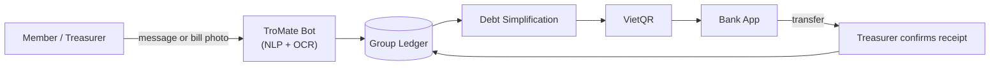

# TroMate — Roommate Expense & Rent Reconciliation Bot

[-blue.svg)](#status)
-green.svg)
[](#team)
[](#platform-and-services)

> **The dorm's automatic "chief accountant"** — living right inside your group chat, eliminating the friction of tracking shared money, parsing rent bills, and settling debts.

Practical assignments for **Elements of Software Engineering** (24A01) — Advanced Program in Computer Science (APCS), Faculty of Information Technology, University of Science, VNU-HCM.

---

## Quick Links

- **GitHub Repository:** [AmnO-O/TroMateProject](https://github.com/AmnO-O/TroMateProject)
- **Jira Board:** [APCS CS300 Jira](https://apcs24-cs300.atlassian.net/jira)
- **User Survey Form:** [Google Forms Survey](https://docs.google.com/forms/d/e/1FAIpQLScM5yP4aliMYLqN7aDY88b7SqNZ4aVUaF5TYSiHEhPrL0CenA/viewform)

---

## Overview

TroMate lives directly inside your roommate group chat (Telegram Bot + Mini App) and handles all the shared bookkeeping nobody wants to do manually:

- **Natural-Language Chat Logging:** Turn everyday messages like *"mua nước 50k chia 3"* instantly into structured ledger entries.
- **OCR Rent Bill Parsing:** Extract base rent, electricity/water meter readings, and surcharges from photo invoices (written or printed).
- **Debt Simplification:** Automatically minimize circular debts so members settle with the fewest possible transfers.
- **One-Tap VietQR Settlement:** Generate exact-amount VietQR codes for instant transfers. *Scan ≠ Paid*: treasurer verifies receipt before clearing debt.

---

## Key Features

| Feature | Description |
|---|---|
| **Natural-Language Parsing** | Turns chat text (and text + photo context) into an expense — amount, payer, beneficiaries and description — defaulting to an equal split. |
| **Rent Bill OCR & Meter Scanner** | Reads the rent invoice (base rent, electricity/water readings, surcharges) and cross-checks the hallway meters against it. |
| **Usage Anomaly Detector** | Flags consumption spikes against a 3-month baseline (possible leaks or faults). |
| **Debt Simplification** | Solves minimum cash flow on the member graph to cancel circular debts and minimize transfers. |
| **VietQR Settlement** | EMVCo/NAPAS QR pre-filled with the exact amount and memo; the payee taps *Confirm Received*. |
| **Polite Meme Reminders** | Auto-mentions unsettled members with a meme after 24 hours. |
| **Monthly Report** | End-of-month infographics: electricity/water, shared meals, average per person and trends. |
| **Confirmation State Machine** | Expenses start `PENDING` with Agree / Reject / Edit, auto-commit after 60 seconds, and freeze on rejection. |
| **Mini App / Web UI** | Balance sheets, cash-flow charts, a filterable transaction log, admin edit/delete and group settings. |

---

## How It Works



### Primary User Journeys

1. **Daily Expense:** Message in chat → bot parses → `PENDING` expense broadcast with *Agree / Reject / Edit* → auto-commits after 60 seconds → group ledger.
2. **Monthly Rent Bill:** Bill photo → OCR extraction → human review/approval → offset advances → minimize debts → per-member VietQR → treasurer confirms receipt.

Detailed user flows and screen inventory are documented in [`pa/PA1-Group06/ui-prototyping/flow.md`](pa/PA1-Group06/ui-prototyping/flow.md).

---

## Platform and Services

TroMate is designed as a **zero-install, mobile-first** application utilizing free-tier infrastructure.

| Component / Service | Technology | Details / Access |
|---|---|---|
| **User Interface** | Telegram Bot API + Mini App | Chat bot interface and embedded Web App shell (also usable as a standalone web app) |
| **Payment Gateway** | VietQR (NAPAS) | Dynamic QR code generation for exact-amount transfers |
| **Backend & Database** | Python / Node.js *(TBD)* | API service, OCR/NLP pipeline, and ledger storage |
| **Secondary Channel** | Zalo API *(Future)* | Potential secondary integration post-MVP |

---

## Project Layout

```text
TroMateProject/
├── docs/                 # Academic project documentation by discipline
│   ├── analysis and design/
│   ├── management/
│   ├── requirements/
│   └── test/
├── pa/                   # Graded course practical assignments
│   ├── PA0/              # Project proposal & tool index
│   └── PA1-Group06/      # Project plan, vision, UI prototyping & weekly reports
├── src/                  # Application source code (populated in Construction phase)
└── README.md             # Project overview & guide
```

---

## Documentation Index

| Deliverable / Artifact | Path / Location |
|---|---|
| **Project Proposal (PA0)** | [`pa/PA0/project-proposal.md`](pa/PA0/project-proposal.md) |
| **Tools & Infrastructure Index (PA0)** | [`pa/PA0/tools.md`](pa/PA0/tools.md) |
| **Software Development Plan (PA1)** | [`pa/PA1-Group06/project-plan/software-development-plan.md`](pa/PA1-Group06/project-plan/software-development-plan.md) |
| **Vision Document (PA1)** | [`pa/PA1-Group06/vision/vision-document.md`](pa/PA1-Group06/vision/vision-document.md) |
| **UI Flows & Screen Inventory (PA1)** | [`pa/PA1-Group06/ui-prototyping/flow.md`](pa/PA1-Group06/ui-prototyping/flow.md) |
| **UI Prompts & Wireframes (PA1)** | [`pa/PA1-Group06/ui-prototyping/ui-prompts.md`](pa/PA1-Group06/ui-prototyping/ui-prompts.md) |

---

## Status

**Current Phase:** `Inception Phase (Sprint 1)`

- [x] Project Proposal & Tool Setup (PA0)
- [x] Problem Validation & User Survey
- [x] Software Development Plan & Task Assignment (PA1)
- [x] Vision Document & UI Wireframing (PA1)
- [ ] Elaboration Phase — Architecture & Spikes (Sprint 2–3)
- [ ] Construction Phase — Development & Testing (Sprint 4–5)

---

## Team

**Group 06 — Elements of Software Engineering (24A01)**

| Student ID | Name | GitHub Handle | Primary Role |
|:---:|:---|:---:|:---|
| `24125008` | Nguyễn Gia Hào | [@hafonium](https://github.com/hafonium) | **Project Manager & Backend Lead** (Ledger, Debt Simplification) |
| `24125010` | Cao Quảng Hưng | [@cqhung](https://github.com/cqhung) | **AI & Bot Engineer** (NLP parsing, Bill OCR) |
| `24125013` | Trịnh Võ Nam Kiệt | [@tvnkiet](https://github.com/tvnkiet) | **Frontend Developer** (Mini App screens) |
| `24125015` | Phạm Hữu Nam | [@AmnO-O](https://github.com/AmnO-O) | **UI/UX & Frontend Developer** (User flows, Design system) |
| `24125020` | Huỳnh Chí Tôn | [@hcton](https://github.com/hcton) | **QA & Technical Writer** (Test plans, Weekly reports) |

---

*Faculty of Information Technology — Advanced Program in Computer Science (APCS)*  
*University of Science, VNU-HCM*
