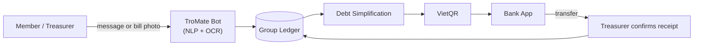

# TroMate — Roommate Expense & Rent Reconciliation Bot

[-blue.svg)](#status)
-green.svg)
[](#team)
[](#platform-and-services)

> **The dorm's automatic "chief accountant"** — living right inside your group chat, eliminating the friction of tracking shared money, parsing rent bills, and settling debts.

Practical assignments for **Elements of Software Engineering** (24A01) — Advanced Program in Computer Science (APCS), Faculty of Information Technology, University of Science, VNU-HCM.

---

## Quick Links

- **GitHub Repository:** [AmnO-O/TroMateProject](https://github.com/AmnO-O/TroMateProject)
- **Jira Board:** [APCS CS300 Jira](https://apcs24-cs300.atlassian.net/jira)
- **User Survey Form:** [Google Forms Survey](https://docs.google.com/forms/d/e/1FAIpQLScM5yP4aliMYLqN7aDY88b7SqNZ4aVUaF5TYSiHEhPrL0CenA/viewform)

---

## Overview

TroMate lives directly inside your roommate group chat (Telegram Bot + Mini App) and handles all the shared bookkeeping nobody wants to do manually:

- **Natural-Language Chat Logging:** Turn everyday messages like *"mua nước 50k chia 3"* instantly into structured ledger entries.
- **OCR Rent Bill Parsing:** Extract base rent, electricity/water meter readings, and surcharges from photo invoices (written or printed).
- **Debt Simplification:** Automatically minimize circular debts so members settle with the fewest possible transfers.
- **One-Tap VietQR Settlement:** Generate exact-amount VietQR codes for instant transfers. *Scan ≠ Paid*: treasurer verifies receipt before clearing debt.

---

## Key Features

| Feature | Description |
|---|---|
| **Natural-Language Parsing** | Turns chat text (and text + photo context) into an expense — amount, payer, beneficiaries and description — defaulting to an equal split. |
| **Rent Bill OCR & Meter Scanner** | Reads the rent invoice (base rent, electricity/water readings, surcharges) and cross-checks the hallway meters against it. |
| **Usage Anomaly Detector** | Flags consumption spikes against a 3-month baseline (possible leaks or faults). |
| **Debt Simplification** | Solves minimum cash flow on the member graph to cancel circular debts and minimize transfers. |
| **VietQR Settlement** | EMVCo/NAPAS QR pre-filled with the exact amount and memo; the payee taps *Confirm Received*. |
| **Polite Automated Reminders** | Scheduled notifications for unsettled balances with direct VietQR quick-action buttons. |
| **Monthly Report** | End-of-month infographics: electricity/water, shared meals, average per person and trends. |
| **Confirmation State Machine** | Expenses start `PENDING` with Agree / Reject / Edit, auto-commit after 5 minutes (opt-out), and freeze on rejection. |
| **Mini App / Personal Ledger** | Personal ledger, balance sheets, room overview, filterable history log, and group settings. |

---

## How It Works



### Primary User Journeys

1. **Daily Expense:** Message in chat (`/new`) → bot parses → `PENDING` expense broadcast with *Agree / Reject / Edit* → auto-commits after 5 minutes → group ledger.
2. **Monthly Rent Bill:** Bill photo → OCR extraction → human review/approval → offset advances → minimize debts → per-member VietQR → treasurer confirms receipt.
3. **Debt Settlement:** Settle balance → generate dynamic VietQR → transfer via mobile banking app → debtor self-reports → recipient confirms.

Detailed user flows and interactive screens are documented in [`pa/PA2-Group06/ui-prototyping/UI_PROTOTYPING.md`](pa/PA2-Group06/ui-prototyping/UI_PROTOTYPING.md).

---

## Platform and Services

TroMate is designed as a **zero-install, mobile-first** application utilizing free-tier infrastructure.

| Component / Service | Technology | Details / Access |
|---|---|---|
| **User Interface** | Telegram Bot API + Mini App (TMA) | Chat bot interface and embedded Web App shell built with React / Tailwind CSS |
| **Payment Gateway** | VietQR (NAPAS 247) | Dynamic QR code generation with pre-filled amount and structured transfer syntax |
| **Backend & Database** | Python / FastAPI, Redis, PostgreSQL | Webhook adapters, state machine, group locks, and ledger storage |
| **Vision & OCR** | Google Cloud Vision / Tesseract | Bill invoice text extraction and meter scanning |

---

## Project Layout

```text
TroMateProject/
├── docs/                             # Living project documentation library
│   ├── analysis-and-design/          # UI design system, technical spikes, use case diagrams
│   ├── management/                   # SDP, MVP plan, weekly reports
│   ├── requirements/                 # Living Vision document
│   └── test/                         # Test plans & cases (planned)
├── pa/                               # Graded course practical assignments
│   ├── PA0/                          # Project proposal & tool index
│   ├── PA1-Group06/                  # PA1 submission package (frozen)
│   └── PA2-Group06/                  # PA2 submission package
│       ├── project-execution-and-tracking/
│       ├── project-plan/             # TroMate_SDP_v2.0.docx
│       ├── ui-prototyping/           # UI_PROTOTYPING.md & flow diagrams
│       ├── use-case-specification/   # usecase-specification.docx & diagram.png
│       ├── vision/                   # rup_vision_sp_v2.9.docx
│       └── weekly-reports/           # weekly-report-03.docx & weekly-report-04.docx
├── src/                              # Application source code
│   └── backend/                      # FastAPI Mini App backend and bot skeleton
└── README.md                         # Project overview & guide
```

---

## Documentation Index

| Deliverable / Artifact | Path / Location |
|---|---|
| **Project Proposal (PA0)** | [`pa/PA0/project-proposal.md`](pa/PA0/project-proposal.md) |
| **Tools & Infrastructure Index (PA0)** | [`pa/PA0/tools.md`](pa/PA0/tools.md) |
| **Software Development Plan (v2.0)** | [`pa/PA2-Group06/project-plan/TroMate_SDP_v2.0.docx`](pa/PA2-Group06/project-plan/TroMate_SDP_v2.0.docx) |
| **Vision Document (v2.0)** | [`pa/PA2-Group06/vision/rup_vision_sp_v2.9.docx`](pa/PA2-Group06/vision/rup_vision_sp_v2.9.docx) |
| **Use Case Specification (12 UCs)** | [`pa/PA2-Group06/use-case-specification/usecase-specification.docx`](pa/PA2-Group06/use-case-specification/usecase-specification.docx) |
| **Use Case Diagram** | [`pa/PA2-Group06/use-case-specification/diagram.png`](pa/PA2-Group06/use-case-specification/diagram.png) |
| **UI Prototyping Specification** | [`pa/PA2-Group06/ui-prototyping/UI_PROTOTYPING.md`](pa/PA2-Group06/ui-prototyping/UI_PROTOTYPING.md) |
| **UI Design System** | [`docs/analysis-and-design/TroMate_UI_Design_System.md`](docs/analysis-and-design/TroMate_UI_Design_System.md) |
| **Technical Spikes: OCR Evaluation** | [`docs/analysis-and-design/TECHNICAL_SPIKES_SCRUM-99_OCR.md`](docs/analysis-and-design/TECHNICAL_SPIKES_SCRUM-99_OCR.md) |
| **Technical Spikes: E-Wallet Integration** | [`docs/analysis-and-design/ewallet.md`](docs/analysis-and-design/ewallet.md) |
| **Telegram Bot Library Evaluation** | [`docs/analysis-and-design/telegram-bot-library-evaluation.md`](docs/analysis-and-design/telegram-bot-library-evaluation.md) |
| **Weekly Reports (Week 1 – 4)** | [`docs/management/weekly-reports/`](docs/management/weekly-reports/) |
| **Documentation Library Index** | [`docs/README.md`](docs/README.md) |

---

## Status

**Current Phase:** `Elaboration Phase (Sprint 2 / PA2 Completed)`

- [x] Project Proposal & Tool Setup (PA0)
- [x] Problem Validation & User Survey
- [x] Baseline Software Development Plan & Vision Document (PA1)
- [x] **Revised SDP v2.0 & Vision Document v2.0 (PA2)**
- [x] **Use Case Model & 12 Detailed Use Case Specifications (PA2)**
- [x] **Interactive UI Prototyping & Flow Diagrams (PA2)**
- [x] **Technical Spikes: OCR Evaluation, Mini App Auth, VietQR, & E-Wallet Research (PA2)**
- [x] **Weekly Reports 03 & 04 (PA2)**
- [ ] Elaboration Phase — Architecture (SAD), Test Plan, & v0.1 Prototype (Sprint 3 / PA3)
- [ ] Construction Phase — Development & Beta Pilot (Sprint 4 / PA4)
- [ ] Transition Phase — Final Release & Acceptance (Sprint 5 / PA5)

---

## Team

**Group 06 — Elements of Software Engineering (24A01)**

| Student ID | Name | GitHub Handle | Primary Role |
|:---:|:---|:---:|:---|
| `24125008` | Nguyễn Gia Hào | [@hafonium](https://github.com/hafonium) | **Technical Lead** (Architecture, ledger, debt engine) |
| `24125010` | Cao Quảng Hưng | [@caoquanghung](https://github.com/caoquanghung) | **QA / Tester** (Test plan, test cases, defect reporting) |
| `24125013` | Trịnh Võ Nam Kiệt | [@namkiet](https://github.com/namkiet) | **Scrum Master / Project Lead** (Process, Jira, plans) |
| `24125015` | Phạm Hữu Nam | [@AmnO-O](https://github.com/AmnO-O) | **UI/UX Designer** (User flows, wireframes, design system) |
| `24125020` | Huỳnh Chí Tôn | [@hikito-otikih](https://github.com/hikito-otikih) | **Product Owner / Business Analyst** (Requirements, user stories) |

---

*Faculty of Information Technology — Advanced Program in Computer Science (APCS)*  
*University of Science, VNU-HCM*
