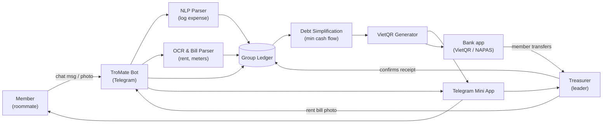
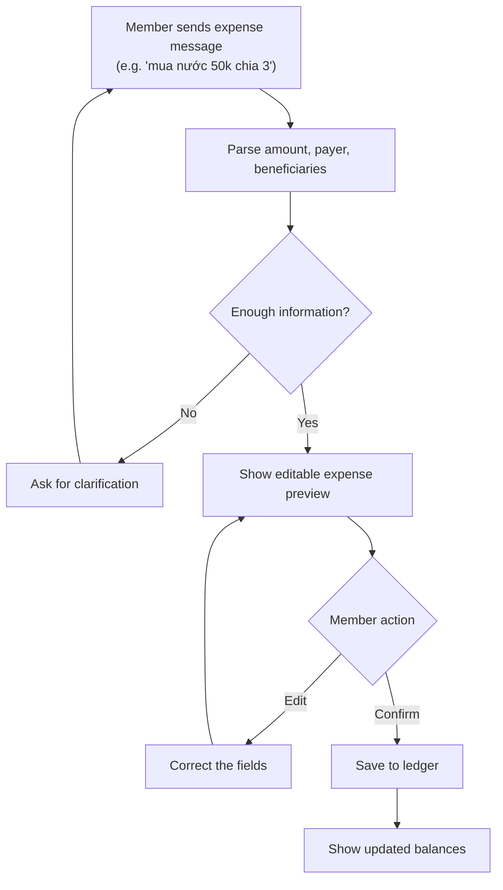
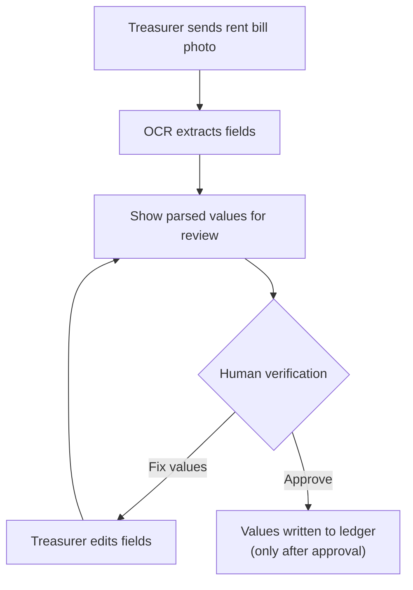
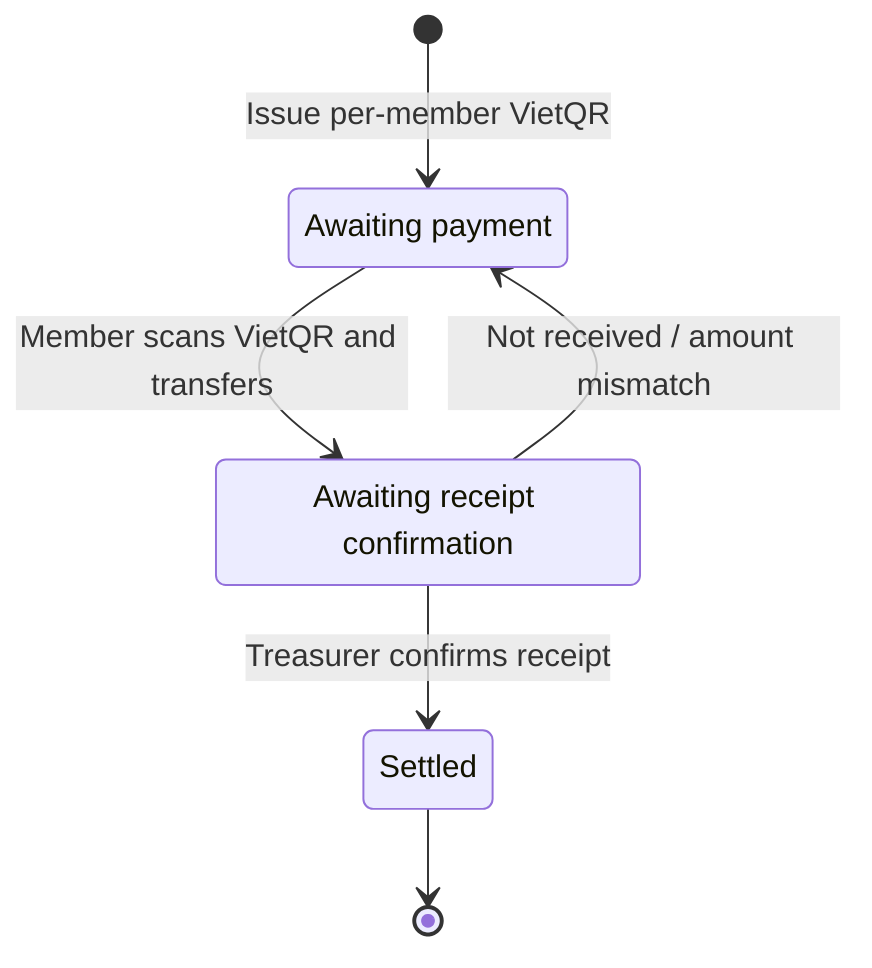
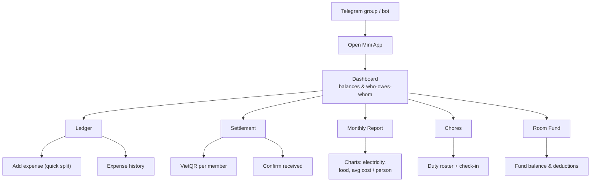

# TroMate — User Flows & Screen Inventory

*Elements of Software Engineering — 24A01 · Group 06 · PA1 UI Prototyping (deliverable c)*

This document captures the **current idea** as flows. It is the input for the UI sketches (3–6 main screens) and the prompts used to generate them.

---

## 1. Actors

| Actor | Role |
|---|---|
| **Member (roommate)** | Logs shared expenses, views balances, receives/settles debts |
| **Treasurer (group leader)** | Pays the landlord, uploads the rent bill, confirms receipt |
| **Landlord** *(indirect)* | Source of the rent invoice (photo) the bot parses |
| **TroMate Bot** | Parses messages/bills, keeps the ledger, computes splits & minimizes debts |
| **Mini App** | Rich UI opened from Telegram, no install |
| **Bank apps (VietQR/NAPAS)** | Where the member actually transfers the money |

---

## 2. High-level system flow

---

## 3. Scenario flows

### 3.1 Daily expense (natural-language logging) — Use Case 1

> **Requirement:** the preview must display the **amount, payer, split method, and beneficiaries**. For example, *"mua nước 50k chia 3"* must **not** silently assume the wrong three people — the beneficiary list is shown and is editable before saving.

### 3.2 Rent bill review (OCR) — Use Case 2

> **Requirement:** OCR can be wrong (handwritten readings, faint receipts, misaligned numbers), so the treasurer **reviews the extracted values before they affect the ledger**. The review screen includes fields for:
>
> - **Base rent**
> - **Previous & current electricity readings** and the **unit price** (new − old × price)
> - **Water usage** and its **unit price**
> - **Surcharges** (e.g. garbage, motorbike parking)
> - **Billing period** (where applicable)
>
> The screen shows the **calculated total** and **flags missing or inconsistent values** (e.g. current reading < previous, unit price = 0) before approval.

### 3.3 Settlement lifecycle — Use Case 3

> **Requirements:**
> - **Scanning a QR code does not confirm payment.** A transfer moves the obligation to *Awaiting receipt confirmation*; the member is shown as paid only once the **treasurer confirms receipt** (or a **verified payment integration** confirms it).
> - The UI exposes **three states**: **Awaiting payment**, **Awaiting receipt confirmation**, and **Settled**.
> - Clearing one debt clears **only that settlement obligation** — it does **not** reset the member's entire room balance if other debts remain.

### 3.4 Mini App navigation (information architecture)

---

## 4. Screen inventory

From the flows above, these are the candidate screens. PA1 requires **3–6 main screens** — the **MVP core** column marks the recommended set.

| # | Screen | Purpose | Source flow | MVP core |
|---|---|---|---|---|
| S1 | **Welcome / Onboarding** | Create/join a room group, invite roommates | — | optional |
| S2 | **Dashboard** | Current balances, who owes whom, quick actions | 3.4 | ✅ |
| S3 | **Add Expense (Quick Split)** | Editable preview of amount, payer, split method, beneficiaries | 3.1 | ✅ |
| S4 | **Rent Bill Review (OCR)** | Review/correct extracted bill fields; flag inconsistencies; approve before ledger | 3.2 | ✅ |
| S5 | **Settlement (VietQR)** | Per-member amount + QR; 3 states (awaiting payment → awaiting receipt confirmation → settled) | 3.3 | ✅ |
| S6 | **Monthly Report** | Expense breakdown & usage charts | 3.4 | ✅ |
| S7 | **Ledger / History** | Chronological list of entries | 3.4 | ✅ |
| S8 | **Chat interaction** (in Telegram, not a screen) | Natural-language logging within the group | 3.1 | — |
| S9 | Chore scheduler | Duty roster + check-in | 3.4 | later |
| S10 | Room fund | Fund balance & deductions | 3.4 | later |
| S11 | Move-in checklist | Asset/deposit photos | — | later |

**Recommended 6 for PA1 sketches:** S2 Dashboard · S3 Add Expense · S4 Rent Bill Review · S5 Settlement (VietQR) · S6 Monthly Report · S7 Ledger.

---

## 5. UI prompts

The paste-ready prompts for the six MVP screens are in [`ui-prompts.md`](./ui-prompts.md). They encode the corrections above: the **editable expense preview** (S3), the **OCR review with inconsistency flags** (S4), and the **three settlement states** (S5).
