# TroMate — UI Technical Detail Specification (Inception Phase / PA1)

* **Project:** TroMate — Telegram Roommate Expense & Rent Reconciliation Bot
* **Jira Epic:** [SCRUM-46 (UI Prototyping)](https://apcs24-cs300.atlassian.net/browse/SCRUM-46)
* **Course Deliverable:** Section `c -- UI Prototyping (5 points)` ([PA1.pdf](../../../lab/PA1.pdf))
* **Author:** TroMate Team
* **Date:** October 18, 2026

---

# PART 1: UI DESIGN SYSTEM & COMPONENT LIBRARY

The TroMate interface is architected for mobile viewports as a Telegram Mini App (TMA), seamlessly integrated with the Telegram group chatbot ecosystem.

### 1.1 Core Design Principles
1. **Stress-Free Financial Experience:** Warm off-white canvas (`#F8F5F0`), soft rounded cards (`20px–22px`), and respectful language ("Room is in balance", "Pending confirmation") to mitigate interpersonal debt tension.
2. **Single Primary CTA per View:** Each view provides exactly one high-contrast Primary action to prevent mistaken transfers or erroneous approvals.
3. **Triad Status Feedback:** Every status indicator combines an **Icon + Text Label + Color Token** to ensure immediate comprehension and accessibility.
4. **Unambiguous Currency Display:** Real-time thousand-separated values (e.g., `250.000đ`, avoiding truncated slang like `250k`).

---

### 1.2 Design Tokens

#### Semantic Color Tokens

| Token Variable | Hex Code | Role & Application |
| :--- | :---: | :--- |
| `--bg-canvas` | `#F8F5F0` | Global app background (warm off-white) |
| `--bg-surface` | `#FFFFFF` | Cards, modals, bottom sheets |
| `--bg-subtle` | `#F4F0E9` | Nested containers (bank info, copy boxes) |
| `--border-default` | `#ECE5DA` | 1px card borders and horizontal dividers |
| `--brand-teal` | `#1F6F68` | Primary CTA buttons, active tabs, highlights |
| `--brand-tealSoft` | `#E2EEEB` | Secondary buttons, action chips |
| `--status-orange` | `#BF5520` | Debt warnings ("You owe", "Unpaid") |
| `--status-orangeSoft` | `#FBE7DB` | Warning card background |
| `--status-amber` | `#8A6100` | "Pending approval", "New room" |
| `--status-green` | `#2E7D4F` | "Settled", "To collect", "Period completed" |
| `--status-greenSoft` | `#E1F0E5` | Settlement success card background |
| `--status-red` | `#B3261E` | QR generation errors, rejection actions |

#### Typography & Viewport Standards
* **Typeface:** `Be Vietnam Pro` (complete Vietnamese diacritics support).
* **Line Height:** Minimum $\ge 1.3\times$ font-size to prevent diacritic clipping on mobile screens.
* **Layout Grid:** 360px base mobile width, 16px screen padding, 14px–16px card spacing.

---

### 1.3 Atomic Component Library

  

1. **Button Component (`Button`):**
   * Standard height: `50px`, border radius: `14px`, `full-width`.
   * Variants: `Primary` (Teal background, white text), `Secondary` (TealSoft background, Teal text), `Ghost` (Transparent, Teal border), `Disabled` (Muted gray `#ECE8E1`), `Danger` (Soft red).
2. **StatusChip Component (`StatusChip`):**
   * Pill badge (`padding 4px × 10px`), radius: `999px`.
   * Composed of a 14px icon + label: `Unpaid` (Alert), `Pending` (Clock), `Confirmed` (Check), `QR Error` (Alert).
3. **Avatar Component (`Avatar`):**
   * 36px circular avatar with 2px white border, displaying first initial (`L` - Linh, `M` - Minh, `A` - An, `H` - Hanh).
4. **TabBar Component (`TabBar`):**
   * Fixed bottom navigation bar with 3 items: `Room` (Home), `Balance` (Wallet), `History` (Ledger).

---

# PART 2: USER FLOWS & SCREEN SPECIFICATIONS

---

## FLOW 0: Room Onboarding & Setup Flow (FR-01)

### 1. User Flow Scenario
Room admin invites `@TroMateBot` to a Telegram group ➔ runs `/setup` ➔ Bot issues a setup link ➔ Admin opens Mini App ➔ inputs Room Name (`Room 203`), Monthly Cutoff Date (e.g., 30th), Initial Reserve Fund (`500.000đ`), and Bank Account Details (Bank name, Account Number, Account Holder) ➔ taps "Complete & Invite Members" ➔ Bot posts an invite link to the group ➔ Dashboard transitions to Empty State.

### 2. User Flow Diagram
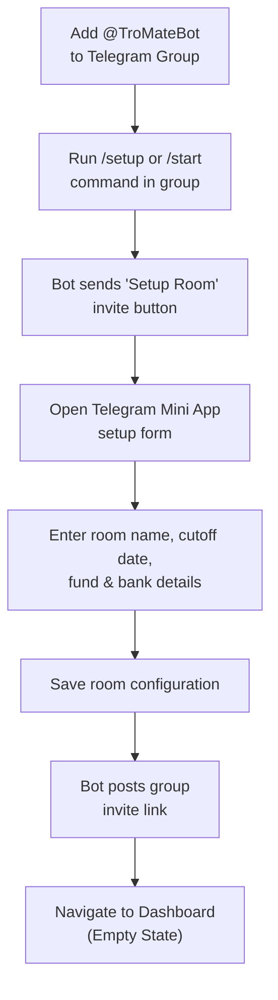

### 3. Screen Specifications

#### Screen 0.1: Telegram Bot /start Command & Mini App Launch ([SCRUM-19](https://apcs24-cs300.atlassian.net/browse/SCRUM-19))
* **Purpose:** Initial onboarding and entry point from Telegram chat to the TroMate Mini App.

  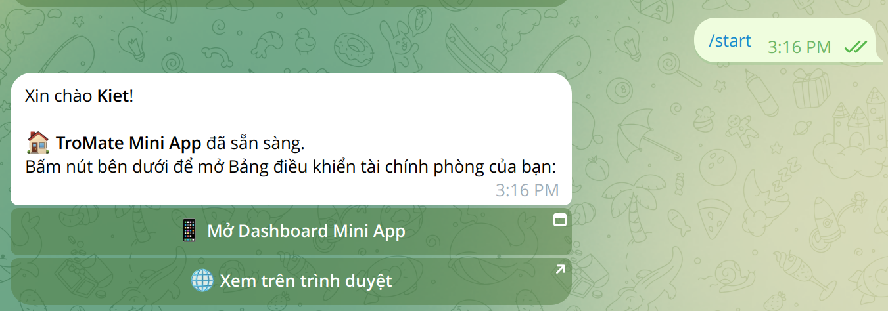

* **UI Elements:**
  * User command: `/start` (or `/setup`).
  * Bot response bubble with personalized greeting (`Xin chào Kiet!`) and ready status notice.
  * Inline Action Buttons:
    * Primary CTA: `[ 📱 Mở Dashboard Mini App ]` (launches Telegram Mini App with room context).
    * Secondary Link: `[ 🌐 Xem trên trình duyệt ]` (external web fallback).

#### Screen 0.2: Room Dashboard — Empty State ([SCRUM-69](https://apcs24-cs300.atlassian.net/browse/SCRUM-69))
* **Purpose:** Confirms room creation and prompts the first expense entry upon successful onboarding.

  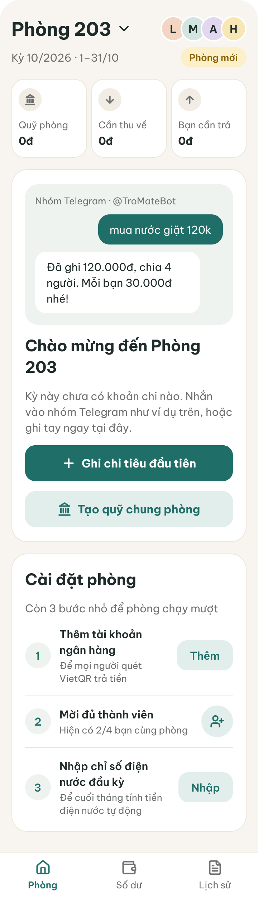

* **UI Elements:** Header with room title `Room 203`, amber `New Room` badge, onboarding checklist card, and Primary CTA: `Log First Expense`.

---

## FLOW 1: Expense Creation & Split Flow (FR-02)

### 1. User Flow Scenario
A member incurs a shared expense ➔ opens Expense Library ➔ taps "+ Add Expense" ➔ enters expense details (name, amount, date, payer) ➔ selects stakeholders and split method (equal / percentage / exact) ➔ verifies individual shares ➔ taps "Save Expense" ➔ system stores the record and updates room balances.

### 2. User Flow Diagram
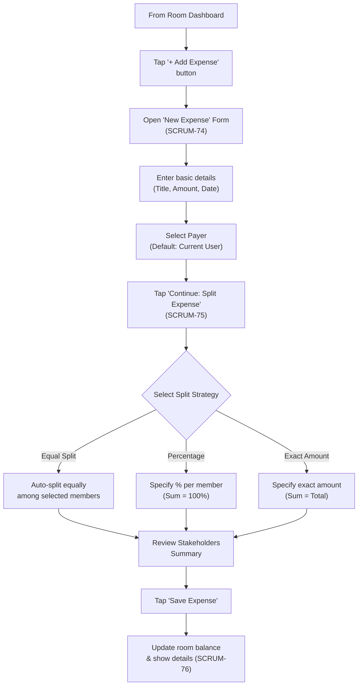

### 3. Screen Specifications

#### Screen 1.1: Expense Library
* **Purpose:** Central list of all recorded and pending room expenditures.

  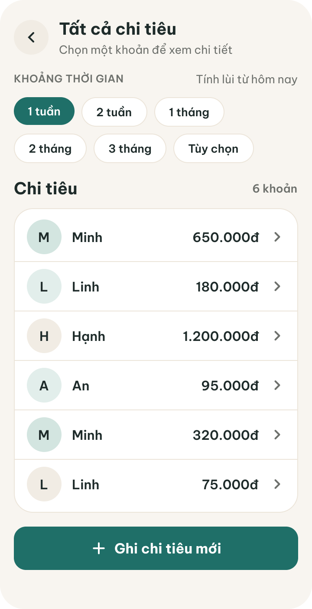

* **UI Elements:** Search bar, category filter chips (`All`, `Rent`, `Electricity`, `Water`, `Groceries`), expense cards with category icon, title, date, amount. Bottom Primary CTA: `+ Add Expense`.

#### Screen 1.2: Add Expense Form ([SCRUM-73](https://apcs24-cs300.atlassian.net/browse/SCRUM-73), [SCRUM-74](https://apcs24-cs300.atlassian.net/browse/SCRUM-74))
* **Purpose:** Captures detailed financial attributes of the transaction.

  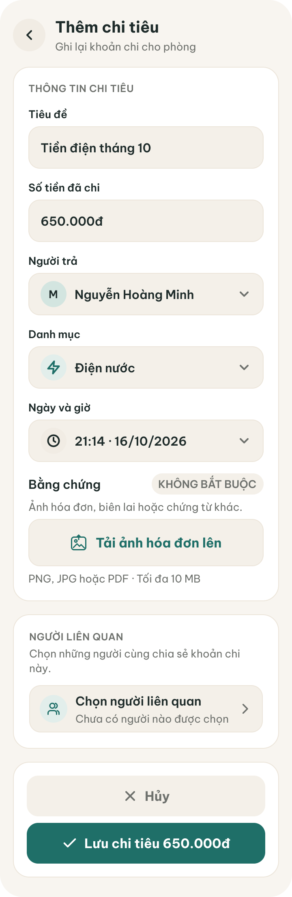

* **UI Elements & Inputs:** Title (`text input`), Amount (`currency input`, real-time VND format), Category selector, Payer selector. Primary CTA: `Select Stakeholders`.

#### Screen 1.3: Select Stakeholders & Split Breakdown ([SCRUM-75](https://apcs24-cs300.atlassian.net/browse/SCRUM-75))
* **Purpose:** Designates responsible members and validates split math.

| Select Stakeholders | Split Details Summary |
| :---: | :---: |
| 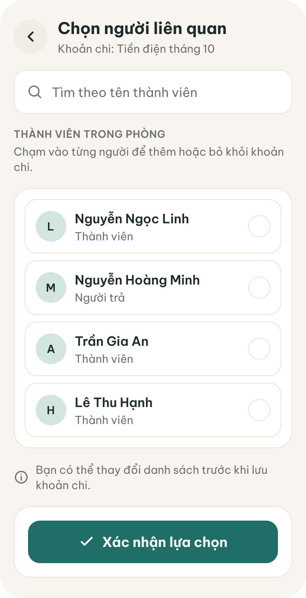 | 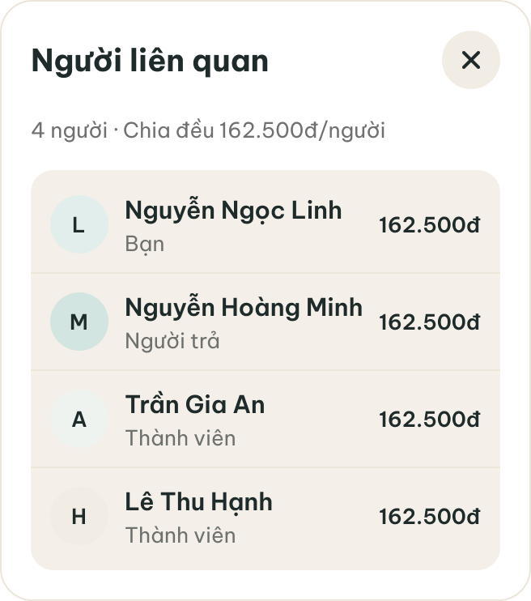 |

* **UI Elements:** Member checkboxes (`Linh`, `Minh`, `An`, `Hanh`), `Select All` toggle, dynamic share calculation display (`162.500đ / person`). Primary CTA: `Confirm Stakeholders`.

#### Screen 1.4: Payer Expense Detail ([SCRUM-76](https://apcs24-cs300.atlassian.net/browse/SCRUM-76))
* **Purpose:** Final confirmation view for the payer before ledger commitment.

  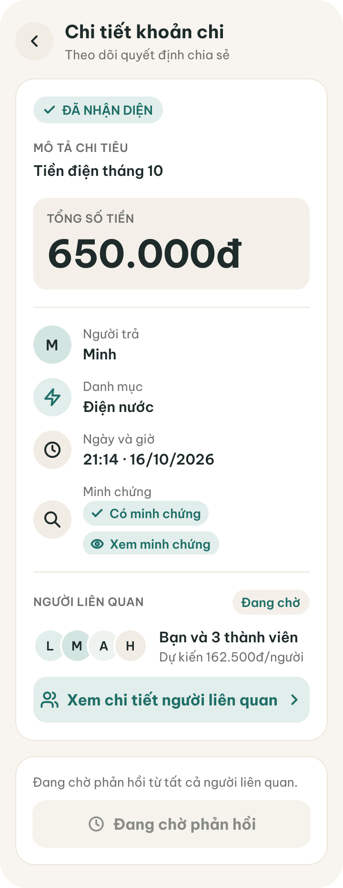

* **UI Elements:** Total banner (`650.000đ`), payer metadata, itemized debtor list, status: `Pending member confirmation`. Primary CTA: `Save Expense`.

---

## FLOW 2: Expense Review & Confirmation Flow (FR-02)

### 1. User Flow Scenario
A roommate reviews an expense where they are tagged as a debtor ➔ opens parsed expense review view ➔ inspects breakdown ➔ taps "Confirm" to accept or "Reject" to dispute ➔ system finalizes the ledger entry.

### 2. User Flow Diagram
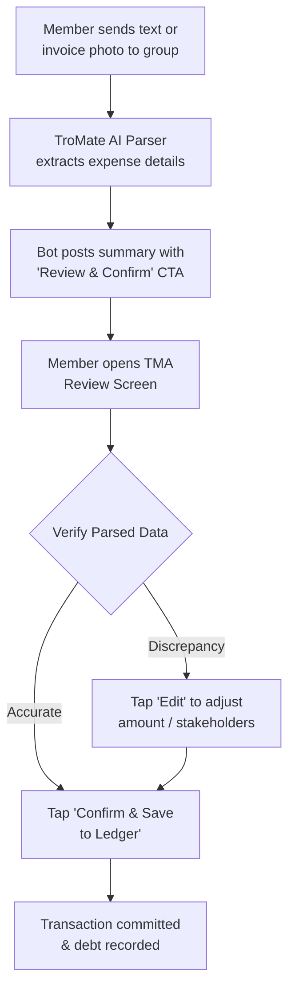

### 3. Screen Specifications

#### Screen 2.1: Expense Library with Review Badges
* **Purpose:** Highlights items requiring user action.

  

* **UI Elements:** Status chips on expense items (Amber: `Needs Review`, Green: `Approved`). Tapping an item opens the review screen.

#### Screen 2.2: Parsed Expense Review & Decision ([SCRUM-73](https://apcs24-cs300.atlassian.net/browse/SCRUM-73), [SCRUM-76](https://apcs24-cs300.atlassian.net/browse/SCRUM-76))
* **Purpose:** Transparent breakdown allowing debtors to approve or contest.

  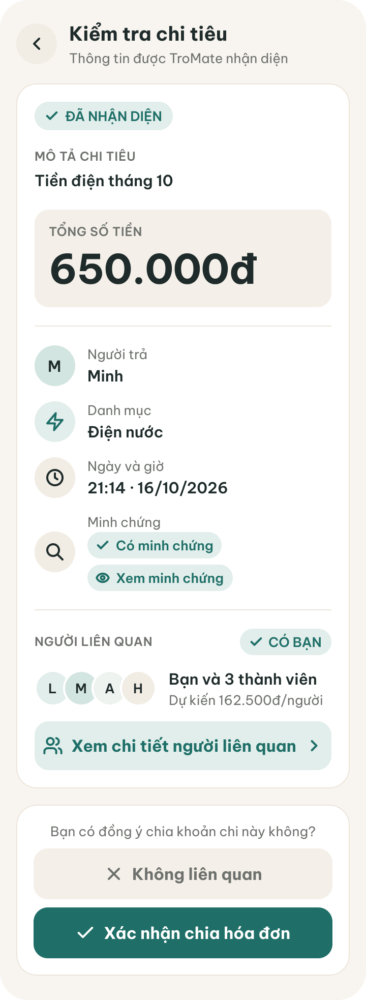

* **UI Elements:** Total amount banner (`650.000đ`), creator info (`Minh`), debtor's individual obligation (`162.500đ`), co-debtors list. Dual action buttons: `Reject / Cancel` (Soft red) vs. `Confirm Expense` (Primary Teal).

---

## FLOW 3: Room Dashboard 4 Contextual States (FR-03)

### 1. User Flow Scenario
A roommate launches the Mini App ➔ system evaluates current balances, pending expenses, and settlement status ➔ dynamically renders one of 4 room states.

### 2. User Flow Diagram
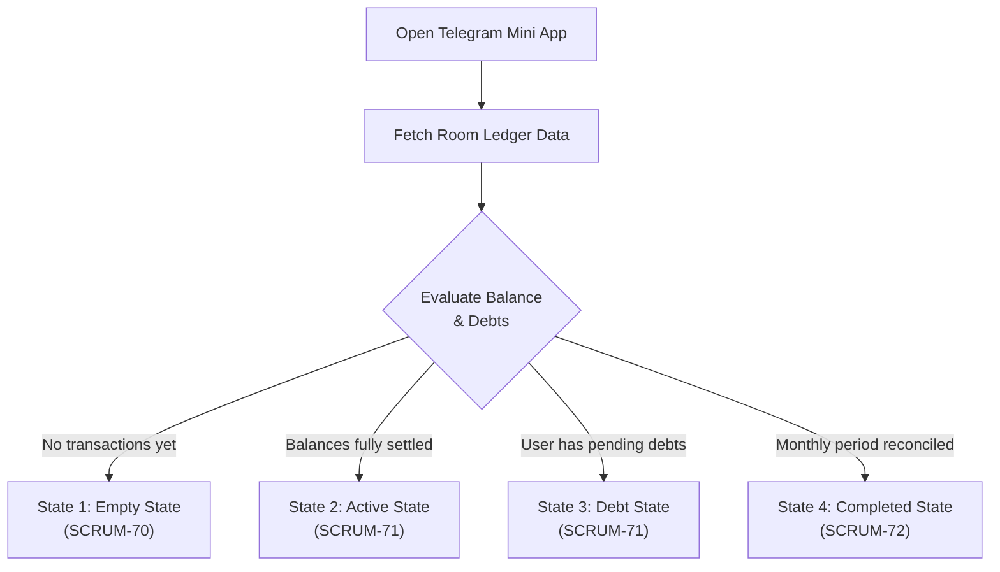

### 3. Screen Specifications: 4 Dashboard States ([SCRUM-69](https://apcs24-cs300.atlassian.net/browse/SCRUM-69), [SCRUM-70](https://apcs24-cs300.atlassian.net/browse/SCRUM-70), [SCRUM-71](https://apcs24-cs300.atlassian.net/browse/SCRUM-71), [SCRUM-72](https://apcs24-cs300.atlassian.net/browse/SCRUM-72))

| State 1: New Room (Empty) | State 2: Normal Activity (Active) |
| :---: | :---: |
|  | 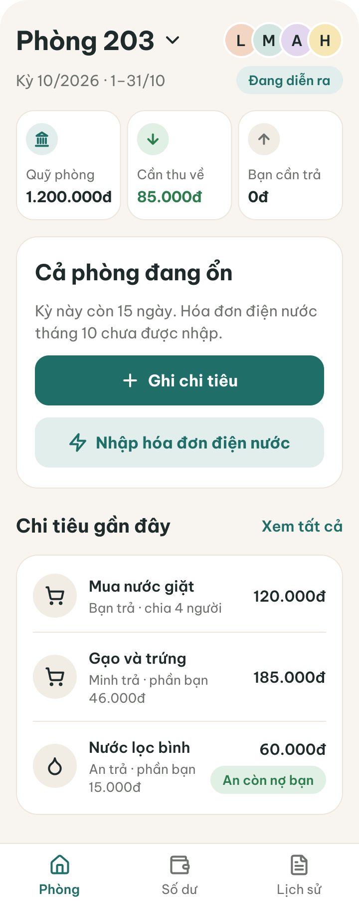 |
| **Empty State:** No transactions yet. Displays setup checklist and `Log First Expense` CTA. | **Active State:** White status card `"Room is in balance"`. Shows Room Fund, receivables/payables, and `+ Log Expense` CTA. |

| State 3: Outstanding Debt | State 4: Period Reconciled |
| :---: | :---: |
| 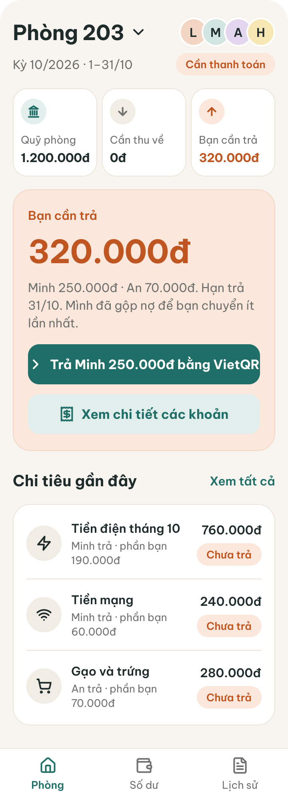 | 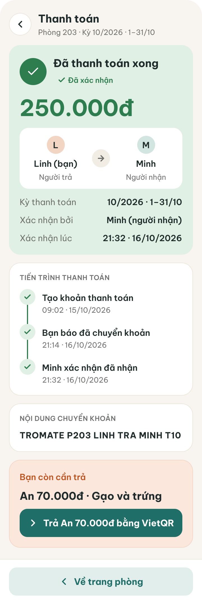 |
| **Debt State:** Soft orange card (`#FBE7DB`) highlighting amount owed (`250.000đ`). Primary CTA: `Pay Minh via VietQR`. | **Completed State:** Soft green card (`#E1F0E5`) confirming period settlement. Ready for the next billing cycle. |

* **Shared Dashboard Elements:**
  * `RoomHeader`: Room title (`Room 203`), active billing period, circular avatar cluster.
  * `3 StatCards`: Room Fund, To Collect (Green), You Owe (Orange).
  * `Recent Transactions`: 3 latest transactions with category icons and `View All` text link.
  * `TabBar`: Navigation tabs (`Room`, `Balance`, `History`).

---

## FLOW 4: Settlement & VietQR Payment Flow (FR-06, FR-07)

### 1. User Flow Scenario
Debtor views outstanding debt ➔ taps "Pay via VietQR" ➔ scans dynamic VietQR code with banking app ➔ taps "I Have Transferred" ➔ status switches to "Pending Approval" ➔ Creditor verifies bank balance and taps "Confirm Receipt" ➔ debt cleared to zero.

### 2. User Flow Diagram
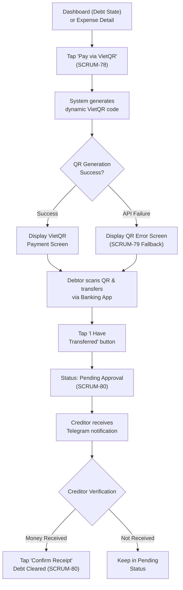

### 3. Screen Specifications

#### Screen 4.1: VietQR Payment & Error Fallback ([SCRUM-77](https://apcs24-cs300.atlassian.net/browse/SCRUM-77), [SCRUM-78](https://apcs24-cs300.atlassian.net/browse/SCRUM-78), [SCRUM-79](https://apcs24-cs300.atlassian.net/browse/SCRUM-79))
* **Purpose:** Provides a standardized VietQR code for exact payment processing.

| VietQR Payment Screen | QR Generation Error Fallback |
| :---: | :---: |
| 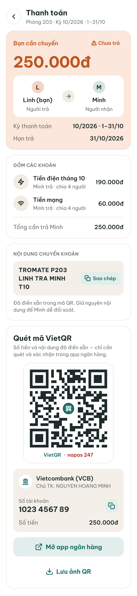 | 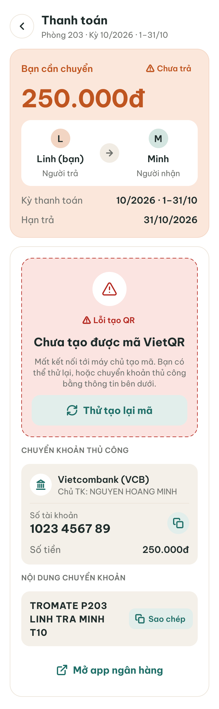 |

* **UI Elements:** Transfer banner (`250.000đ`), debtor-to-creditor indicator (`Linh ➔ Minh`), $200\times 200\text{px}$ dynamic VietQR with Napas 247 logo, bank info container (`Vietcombank`, `NGUYEN HOANG MINH`, `1023 4567 89` with `Copy` button), deep link button `Open Banking App`, Primary CTA: `I Have Transferred`.
* **Exception Handling (QR Error):** On VietQR API failure, renders red alert banner `"Could not generate VietQR"`, `Retry` button, and manual account copy fallback.

#### Screen 4.2: Settlement RBAC Matrix & Completion ([SCRUM-80](https://apcs24-cs300.atlassian.net/browse/SCRUM-80))
* **Purpose:** Restricts payment confirmation authority strictly to the designated creditor.

| 1. Debtor View (Pending) | 2. Creditor View (Approve) | 3. Other Members (Locked) | 4. Settled (Complete) |
| :---: | :---: | :---: | :---: |
| 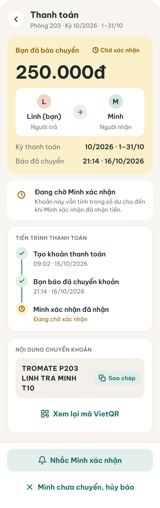 | 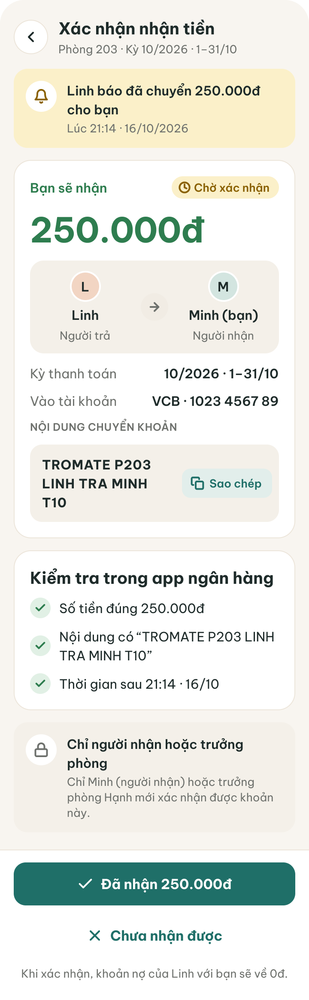 | 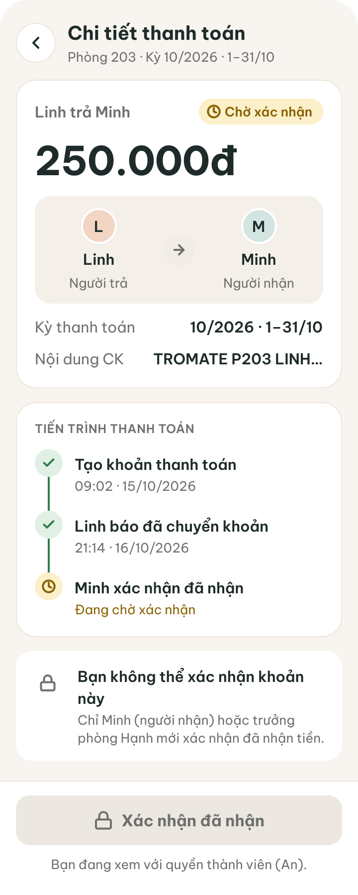 | 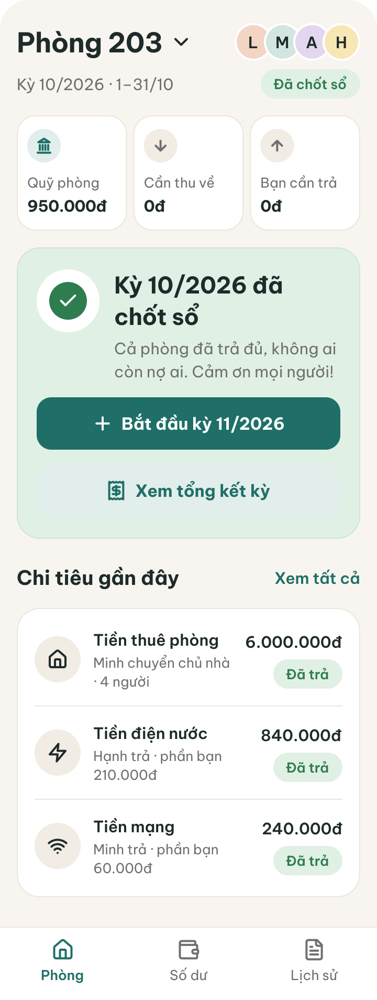 |

* **Role-Based Access Control (RBAC):**
  * *Debtor (Screen 1):* Sees amber chip `Pending confirmation` and transfer timestamp.
  * *Creditor (Screen 2):* Primary Teal CTA enabled: `Received 250.000đ`. Tapping commits settlement.
  * *Other Members (Screen 3):* Button is `Disabled` with a lock icon and helper notice: *"Only the recipient (Minh) or room admin can confirm receipt"*.
  * *Completed (Screen 4):* Green badge `Confirmed`, timeline checkmark, and `Back to Home` CTA.

