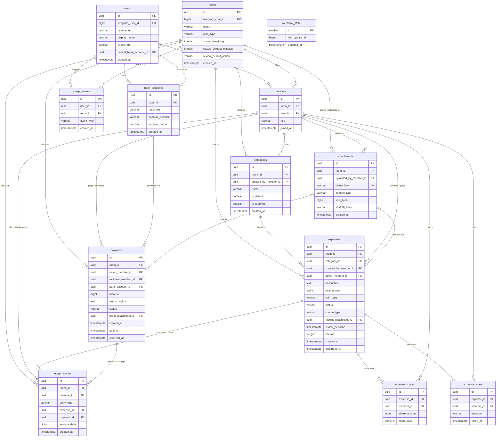

# TroMate — Database Schema, ERD & Storage Architecture (SCRUM-117)

**Date:** November 14, 2026  
**Author:** Kiệt Trịnh Võ Nam (Group 06)  
**Jira Task:** `SCRUM-117` (Design Database Schema (ERD))  
**Aligned With:** `SCRUM-116` (System Component Diagram) & `SCRUM-114` (Use-Case Specification)

---

## 1. Storage Architecture Evaluation & Justification

### 1.1 Candidates Evaluated

| Criterion | File-Based (JSON / CSV) | Embedded SQLite | Managed PostgreSQL (Neon) |
|---|---|---|---|
| **Concurrent Writers** | Unsafe; risk of file corruption across concurrent requests | Single-writer lock (`SQLITE_BUSY`) under concurrent webhook + REST writes | Full MVCC; handles concurrent Telegram webhooks and Mini App API calls |
| **ACID & Transactions** | Manual atomic file swaps; no multi-entity rollback | ACID on single node, but limited horizontal/serverless deployment | Full ACID; commits `expenses.status` + `ledger_entries` in one `AsyncSession` transaction |
| **Optimistic Locking** | Must be hand-rolled | Supported, but constrained by writer lock | Native integer `version` check (`UPDATE ... WHERE id = :id AND version = :v`) |
| **Deployment & Cost** | Zero cost, but ephemeral on serverless/PaaS containers | Local disk required (lost on container restarts) | Serverless scale-to-zero free tier; managed TLS (`sslmode=require`), point-in-time restore, DB branching |
| **Auditability (Append-Only)** | No constraint enforcement | Trigger-based | Role/repository-enforced append-only `ledger_entries` & `usage_events` with indexed time-range queries |

### 1.2 Architectural Decision: PostgreSQL (Neon)

TroMate uses **PostgreSQL on Neon** via **SQLAlchemy 2.0 (async)**, **`asyncpg`**, and **Alembic** migrations, paired with **Cloudflare R2** for binary image storage.

1. **Why a file-based / lightweight store is insufficient:** TroMate has two concurrent entry points writing to shared state—Telegram Bot Webhook (`aiogram 3`) and Mini App REST API (`FastAPI`). Confirming or lazily resolving an overdue expense must atomically update `expenses.status` and append `ledger_entries` (dated at `review_deadline`) in a single transaction, while concurrent member votes/edits rely on `expenses.version` optimistic locking (`409 Conflict`).
2. **Why Neon Serverless PostgreSQL fits the project:** Neon requires zero server administration, scales to zero on the free tier, supports database branching for isolated testing, and provides point-in-time restore.
3. **Media / Receipt Storage Strategy (Cloudflare R2 + `attachments`):** Receipt, meter, landlord invoice, and payment proof images are **not** stored as `BYTEA` blobs in PostgreSQL. Binary files are stored in a private **Cloudflare R2** bucket (S3-compatible API with lifecycle retention rules), while PostgreSQL stores only an `attachments` metadata row (`object_key`, `room_id`, `uploaded_by_member_id`, `content_type`, `size_bytes`, `sha256_hash`).

---

## 2. Entity-Relationship Diagram (3NF)

---

## 3. Normalization (3NF) & Key Design Decisions

1. **Third Normal Form (3NF):**
   - **`users` vs. `members`:** A Telegram user can belong to multiple rooms (`GET /me`). Separating global user identity (`users`) from room-scoped membership (`members`) eliminates duplicate `username`/`display_name`/`is_operator` attributes and resolves the N-N relationship between `users` and `rooms`.
   - **`bank_accounts` separated from `members`:** A user may register multiple bank accounts (e.g., different VietQR-supported banks) and avoid sparse `NULL` columns on `members`. `users.default_bank_account_id` (`FK -> bank_accounts(id) ON DELETE SET NULL`) structurally guarantees at most one default account per user (avoiding multiple `is_default = TRUE` rows), while `payments.bank_account_id` references the exact account used when the VietQR was generated, preserving historical accuracy if the user later changes their default account.
   - **`expense_shares` and `expense_votes`:** Resolve the N-N relationships between `expenses` and `members` for custom/equal splits and pending-expense voting, each with a `UNIQUE(expense_id, member_id)` constraint.
   - **No transitive dependencies:** Monetary amounts are stored in integer VND (`BIGINT`) to avoid floating-point rounding errors. Category names live only in `categories`; bank details live only in `bank_accounts`.
2. **Direct Review Timeout Configuration (Event-Driven, No Scheduler):**
   - The Room Leader (`ROOM_REP`) updates `rooms.review_timeout_minutes` and `rooms.review_default_action` (`CONFIRM` or `DECLINE`) directly without a room-wide proposal/vote flow, so `TimeoutVote` / `timeout-proposals` tables are not needed.
   - Pending expenses store `review_deadline`; overdue expenses are resolved lazily on the next REST or Telegram request for that room (`resolve_overdue(room)`).
3. **Immutable Append-Only Tables:**
   - `ledger_entries` and `usage_events` have no `UPDATE` or `DELETE` operations in their repositories (`LedgerRepository`, `UsageRepository`). Balance corrections or reversals are recorded as compensating entries.
   - `ledger_entries.created_at` supports the 30-day retention filter for `FREE` rooms (`LedgerService`).
4. **Concurrency & Idempotency:**
   - `expenses.version` provides optimistic locking for concurrent Agree/Reject/Edit actions.
   - `webhook_state.last_update_id` persists the last processed Telegram `update_id` to ignore duplicate webhook deliveries.

---

## 4. Data Dictionary

### 4.1 `users`
Global Telegram user identity and App Operator flag.

| Column | Type | Constraints | Description |
|---|---|---|---|
| `id` | `UUID` | `PK, DEFAULT gen_random_uuid()` | Internal user identifier |
| `telegram_user_id` | `BIGINT` | `NOT NULL, UNIQUE` | Telegram numeric user ID |
| `username` | `VARCHAR(64)` | `NULL` | Telegram `@username` |
| `display_name` | `VARCHAR(128)` | `NOT NULL` | Display name shown in UI & cards |
| `is_operator` | `BOOLEAN` | `NOT NULL, DEFAULT FALSE` | Grants access to `/operator/stats` |
| `default_bank_account_id` | `UUID` | `NULL, FK -> bank_accounts(id) ON DELETE SET NULL` | User's default bank account for VietQR generation |
| `created_at` | `TIMESTAMPTZ` | `NOT NULL, DEFAULT now()` | First seen timestamp |

### 4.2 `bank_accounts`
User-owned bank accounts used to generate VietQR settlement payloads.

| Column | Type | Constraints | Description |
|---|---|---|---|
| `id` | `UUID` | `PK, DEFAULT gen_random_uuid()` | Bank account record ID |
| `user_id` | `UUID` | `NOT NULL, FK -> users(id) ON DELETE CASCADE` | Account owner |
| `bank_bin` | `VARCHAR(16)` | `NOT NULL` | NAPAS 247 bank BIN code (e.g. `970436`) |
| `account_number` | `VARCHAR(32)` | `NOT NULL` | Recipient bank account number |
| `account_name` | `VARCHAR(128)` | `NOT NULL` | Account holder name |
| `created_at` | `TIMESTAMPTZ` | `NOT NULL, DEFAULT now()` | Creation timestamp |

### 4.3 `rooms`
Roommate group workspace bound to a Telegram group chat.

| Column | Type | Constraints | Description |
|---|---|---|---|
| `id` | `UUID` | `PK, DEFAULT gen_random_uuid()` | Room identifier |
| `telegram_chat_id` | `BIGINT` | `NOT NULL, UNIQUE` | Bound Telegram group chat ID |
| `name` | `VARCHAR(128)` | `NOT NULL` | Room display name |
| `plan_type` | `VARCHAR(16)` | `NOT NULL, DEFAULT 'FREE', CHECK (plan_type IN ('FREE', 'PRO'))` | Subscription tier (controls 30-day retention & scan quota) |
| `scans_remaining` | `INTEGER` | `NOT NULL, DEFAULT 10, CHECK (scans_remaining >= 0)` | Remaining OCR/AI photo scans |
| `review_timeout_minutes` | `INTEGER` | `NOT NULL, DEFAULT 5, CHECK (review_timeout_minutes > 0)` | Review timeout in minutes before default action applies; editable by `ROOM_REP` |
| `review_default_action` | `VARCHAR(16)` | `NOT NULL, DEFAULT 'CONFIRM', CHECK (review_default_action IN ('CONFIRM', 'DECLINE'))` | Default action applied to overdue pending expenses; editable by `ROOM_REP` |
| `created_at` | `TIMESTAMPTZ` | `NOT NULL, DEFAULT now()` | Creation timestamp |

### 4.4 `members`
Membership linking a `users` record to a `rooms` record.

| Column | Type | Constraints | Description |
|---|---|---|---|
| `id` | `UUID` | `PK, DEFAULT gen_random_uuid()` | Membership ID |
| `room_id` | `UUID` | `NOT NULL, FK -> rooms(id) ON DELETE CASCADE` | Target room |
| `user_id` | `UUID` | `NOT NULL, FK -> users(id) ON DELETE CASCADE` | Target user |
| `role` | `VARCHAR(16)` | `NOT NULL, DEFAULT 'MEMBER', CHECK (role IN ('MEMBER', 'ROOM_REP'))` | Room-level permission role |
| `joined_at` | `TIMESTAMPTZ` | `NOT NULL, DEFAULT now()` | Join timestamp |
| *Table constraint* | | `UNIQUE(room_id, user_id)` | One membership per user per room |

### 4.5 `categories`
Default and Room Rep-defined custom expense categories per room.

| Column | Type | Constraints | Description |
|---|---|---|---|
| `id` | `UUID` | `PK, DEFAULT gen_random_uuid()` | Category ID |
| `room_id` | `UUID` | `NOT NULL, FK -> rooms(id) ON DELETE CASCADE` | Owning room |
| `created_by_member_id` | `UUID` | `NULL, FK -> members(id) ON DELETE SET NULL` | Creator (`NULL` for system defaults) |
| `name` | `VARCHAR(64)` | `NOT NULL` | Category display name |
| `is_default` | `BOOLEAN` | `NOT NULL, DEFAULT FALSE` | Whether seeded by system |
| `is_archived` | `BOOLEAN` | `NOT NULL, DEFAULT FALSE` | Soft-archived by `ROOM_REP` |
| `created_at` | `TIMESTAMPTZ` | `NOT NULL, DEFAULT now()` | Creation timestamp |
| *Table constraint* | | `UNIQUE(room_id, name)` | Prevents duplicate category names in a room |

### 4.6 `attachments`
Metadata for receipt, meter, landlord invoice, and payment proof images stored in Cloudflare R2.

| Column | Type | Constraints | Description |
|---|---|---|---|
| `id` | `UUID` | `PK, DEFAULT gen_random_uuid()` | Attachment ID (used in `GET /api/v1/images/{image_id}`) |
| `room_id` | `UUID` | `NOT NULL, FK -> rooms(id) ON DELETE CASCADE` | Owning room (checked for access control) |
| `uploaded_by_member_id` | `UUID` | `NOT NULL, FK -> members(id) ON DELETE RESTRICT` | Member who uploaded the image |
| `object_key` | `VARCHAR(512)` | `NOT NULL, UNIQUE` | Key inside the private Cloudflare R2 bucket |
| `content_type` | `VARCHAR(64)` | `NOT NULL` | MIME type (e.g. `image/jpeg`, `image/png`) |
| `size_bytes` | `BIGINT` | `NOT NULL, CHECK (size_bytes > 0)` | File size in bytes |
| `sha256_hash` | `CHAR(64)` | `NOT NULL` | SHA-256 checksum of the image payload |
| `created_at` | `TIMESTAMPTZ` | `NOT NULL, DEFAULT now()` | Upload timestamp |

### 4.7 `expenses`
Shared expenses parsed from chat text, receipt photos, or utility meters.

| Column | Type | Constraints | Description |
|---|---|---|---|
| `id` | `UUID` | `PK, DEFAULT gen_random_uuid()` | Expense ID |
| `room_id` | `UUID` | `NOT NULL, FK -> rooms(id) ON DELETE CASCADE` | Owning room |
| `category_id` | `UUID` | `NOT NULL, FK -> categories(id) ON DELETE RESTRICT` | Assigned category |
| `created_by_member_id` | `UUID` | `NOT NULL, FK -> members(id) ON DELETE RESTRICT` | Member who logged the expense |
| `payer_member_id` | `UUID` | `NOT NULL, FK -> members(id) ON DELETE RESTRICT` | Member who paid upfront |
| `description` | `TEXT` | `NOT NULL` | Item/expense description |
| `total_amount` | `BIGINT` | `NOT NULL, CHECK (total_amount > 0)` | Total amount in VND |
| `split_type` | `VARCHAR(20)` | `NOT NULL, CHECK (split_type IN ('EQUAL', 'CUSTOM_AMOUNT', 'CUSTOM_RATIO'))` | Split calculation mode |
| `status` | `VARCHAR(16)` | `NOT NULL, DEFAULT 'PENDING', CHECK (status IN ('PENDING', 'CONFIRMED', 'REJECTED', 'CANCELLED'))` | Confirmation state machine |
| `source_type` | `VARCHAR(16)` | `NOT NULL, CHECK (source_type IN ('TEXT', 'PHOTO', 'METER'))` | Input channel |
| `receipt_attachment_id` | `UUID` | `NULL, FK -> attachments(id) ON DELETE SET NULL` | Linked receipt/meter image in Cloudflare R2 |
| `review_deadline` | `TIMESTAMPTZ` | `NULL` | Deadline evaluated lazily by `resolve_overdue(room)` |
| `version` | `INTEGER` | `NOT NULL, DEFAULT 1` | Optimistic locking counter |
| `created_at` | `TIMESTAMPTZ` | `NOT NULL, DEFAULT now()` | Creation timestamp |
| `confirmed_at` | `TIMESTAMPTZ` | `NULL` | Timestamp when confirmed (manual or auto) |

### 4.8 `expense_shares`
Per-member share breakdown for an expense.

| Column | Type | Constraints | Description |
|---|---|---|---|
| `id` | `UUID` | `PK, DEFAULT gen_random_uuid()` | Share ID |
| `expense_id` | `UUID` | `NOT NULL, FK -> expenses(id) ON DELETE CASCADE` | Parent expense |
| `member_id` | `UUID` | `NOT NULL, FK -> members(id) ON DELETE RESTRICT` | Participating debtor/member |
| `share_amount` | `BIGINT` | `NOT NULL, CHECK (share_amount >= 0)` | Calculated VND share |
| `share_ratio` | `NUMERIC(8,4)` | `NULL, CHECK (share_ratio > 0)` | Custom ratio/weight when `split_type = 'CUSTOM_RATIO'` |
| *Table constraint* | | `UNIQUE(expense_id, member_id)` | One share row per member per expense |

### 4.9 `expense_votes`
Member confirmation votes (`AGREE` / `REJECT`) on a `PENDING` expense.

| Column | Type | Constraints | Description |
|---|---|---|---|
| `id` | `UUID` | `PK, DEFAULT gen_random_uuid()` | Vote ID |
| `expense_id` | `UUID` | `NOT NULL, FK -> expenses(id) ON DELETE CASCADE` | Target expense |
| `member_id` | `UUID` | `NOT NULL, FK -> members(id) ON DELETE CASCADE` | Voting member |
| `decision` | `VARCHAR(16)` | `NOT NULL, CHECK (decision IN ('AGREE', 'REJECT'))` | Vote choice |
| `voted_at` | `TIMESTAMPTZ` | `NOT NULL, DEFAULT now()` | Vote timestamp |
| *Table constraint* | | `UNIQUE(expense_id, member_id)` | One active vote per member per expense (reset on edit) |

### 4.10 `payments`
VietQR debt settlement transfers between two room members.

| Column | Type | Constraints | Description |
|---|---|---|---|
| `id` | `UUID` | `PK, DEFAULT gen_random_uuid()` | Payment ID |
| `room_id` | `UUID` | `NOT NULL, FK -> rooms(id) ON DELETE CASCADE` | Room context |
| `payer_member_id` | `UUID` | `NOT NULL, FK -> members(id) ON DELETE RESTRICT` | Debtor sending money |
| `recipient_member_id` | `UUID` | `NOT NULL, FK -> members(id) ON DELETE RESTRICT` | Creditor receiving money (`<> payer_member_id`) |
| `bank_account_id` | `UUID` | `NULL, FK -> bank_accounts(id) ON DELETE SET NULL` | Recipient bank account snapshot used for VietQR |
| `amount` | `BIGINT` | `NOT NULL, CHECK (amount > 0)` | Settlement amount in VND |
| `vietqr_payload` | `TEXT` | `NOT NULL` | EMVCo/NAPAS TLV QR payload string |
| `status` | `VARCHAR(16)` | `NOT NULL, DEFAULT 'PENDING', CHECK (status IN ('PENDING', 'PAID', 'RECEIVED'))` | Settlement lifecycle |
| `proof_attachment_id` | `UUID` | `NULL, FK -> attachments(id) ON DELETE SET NULL` | Optional transfer proof image in Cloudflare R2 |
| `created_at` | `TIMESTAMPTZ` | `NOT NULL, DEFAULT now()` | Creation timestamp |
| `paid_at` | `TIMESTAMPTZ` | `NULL` | Timestamp when payer marked paid |
| `received_at` | `TIMESTAMPTZ` | `NULL` | Timestamp when recipient confirmed receipt |

### 4.11 `ledger_entries` *(Append-Only)*
Immutable financial ledger recording confirmed expenses and received settlements.

| Column | Type | Constraints | Description |
|---|---|---|---|
| `id` | `UUID` | `PK, DEFAULT gen_random_uuid()` | Ledger entry ID |
| `room_id` | `UUID` | `NOT NULL, FK -> rooms(id) ON DELETE CASCADE` | Room context |
| `member_id` | `UUID` | `NOT NULL, FK -> members(id) ON DELETE RESTRICT` | Member whose balance changes |
| `entry_type` | `VARCHAR(16)` | `NOT NULL, CHECK (entry_type IN ('EXPENSE', 'SETTLEMENT'))` | Source transaction type |
| `expense_id` | `UUID` | `NULL, FK -> expenses(id) ON DELETE RESTRICT` | Linked expense when `entry_type = 'EXPENSE'` |
| `payment_id` | `UUID` | `NULL, FK -> payments(id) ON DELETE RESTRICT` | Linked payment when `entry_type = 'SETTLEMENT'` |
| `amount_delta` | `BIGINT` | `NOT NULL, CHECK (amount_delta <> 0)` | Signed VND delta (`+` owed to member, `-` member owes) |
| `created_at` | `TIMESTAMPTZ` | `NOT NULL, DEFAULT now()` | Commit timestamp |
| *Table constraint* | | `CHECK ((entry_type = 'EXPENSE' AND expense_id IS NOT NULL AND payment_id IS NULL) OR (entry_type = 'SETTLEMENT' AND payment_id IS NOT NULL AND expense_id IS NULL))` | Enforces exact polymorphic source |

### 4.12 `usage_events` *(Append-Only)*
Operator analytics events for DAU/MAU, peak hours, and peak months.

| Column | Type | Constraints | Description |
|---|---|---|---|
| `id` | `UUID` | `PK, DEFAULT gen_random_uuid()` | Event ID |
| `user_id` | `UUID` | `NULL, FK -> users(id) ON DELETE SET NULL` | Acting user |
| `room_id` | `UUID` | `NULL, FK -> rooms(id) ON DELETE SET NULL` | Room context (if applicable) |
| `event_type` | `VARCHAR(64)` | `NOT NULL` | Event name (e.g. `BOT_EXPENSE_LOG`, `MINIAPP_OPEN`, `VIETQR_GENERATE`) |
| `created_at` | `TIMESTAMPTZ` | `NOT NULL, DEFAULT now()` | Event timestamp |

### 4.13 `webhook_state`
Stores Telegram webhook deduplication state.

| Column | Type | Constraints | Description |
|---|---|---|---|
| `id` | `SMALLINT` | `PK, DEFAULT 1, CHECK (id = 1)` | Singleton row guard |
| `last_update_id` | `BIGINT` | `NOT NULL, DEFAULT 0` | Highest processed Telegram `update_id` |
| `updated_at` | `TIMESTAMPTZ` | `NOT NULL, DEFAULT now()` | Last update timestamp |

### 4.14 Recommended Indexes

- `expenses(room_id, status, review_deadline)` — fast lazy `resolve_overdue(room)` check for `status = 'PENDING'` and `review_deadline <= now()` on incoming room requests.
- `ledger_entries(room_id, created_at DESC)` & `ledger_entries(member_id, created_at DESC)` — fast Debt Engine net balance aggregation and 30-day retention queries.
- `usage_events(created_at)` & `usage_events(user_id, created_at)` — fast operator DAU/MAU and peak-hour/month aggregations.
- `bank_accounts(user_id)` — fast lookup of all bank accounts belonging to a user (the default account is resolved directly via `users.default_bank_account_id`).

---

## 5. Traceability & Sync Notes with `SCRUM-116`

| `SCRUM-116` Repository | Mapped Tables in `SCRUM-117` |
|---|---|
| `RoomRepository` | `users`, `bank_accounts`, `rooms`, `members`, `categories` |
| `ExpenseRepository` | `expenses`, `expense_shares`, `expense_votes`, `attachments` |
| `LedgerRepository` | `ledger_entries` |
| `PaymentRepository` | `payments` *(links to `attachments` via `proof_attachment_id`)* |
| `UsageRepository` | `usage_events` |
| `UnitOfWork` / Webhook | `webhook_state` |

**Sync notes for `SCRUM-116` (Component Diagram) & `SCRUM-114` (Use-Case Specification):**
1. **Review timeout & default action:** Changed to direct configuration by `ROOM_REP` (`rooms.review_timeout_minutes`, `rooms.review_default_action`), removing `TimeoutVote`, `propose_timeout`, `vote_timeout`, `post_timeout_poll`, and the two `/timeout-proposals` endpoints.
2. **Bank accounts:** Separated into `bank_accounts` (`users 1-N bank_accounts`, with `users.default_bank_account_id`) so users can manage multiple bank accounts without `NULL` columns on `members`.
3. **Cloudflare R2 & `attachments`:** Fully aligned with `SCRUM-116` v1.3—binary images live in Cloudflare R2 and PostgreSQL stores `attachments` metadata (`object_key`, `content_type`, `size_bytes`, `sha256_hash`).
