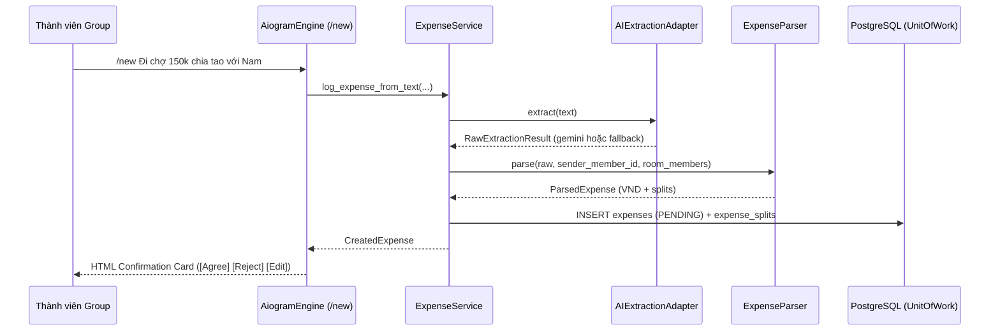

# Subtask 3 Plan & Implementation Notes: Telegram Bot Commands (`/new`) — `SCRUM-123`

## 1. Mục tiêu
Định nghĩa tập lệnh Telegram Bot và luồng xử lý cho **SCRUM-123 (UC01 + UC03b)** theo kiến trúc phân tầng:
`AiogramEngine (/new)` -> `ExpenseService` -> `AIExtractionAdapter (Gemini / vnd_parser)` -> `ExpenseParser` -> PostgreSQL (`PENDING`) -> **Inline Confirmation Card** (`[Agree]`, `[Reject]`, `[Edit]`).

---

## 2. Giới hạn kỹ thuật & Đề xuất dùng lệnh `/new` (Technical Limitation & Trade-off)
Mặc dù kịch bản UC01 gốc mô tả việc người dùng nhắn tin tự do trong group, nhóm áp dụng cú pháp **`/new <nội dung chi tiêu>`** (ví dụ: `/new Đi chợ 150k chia tao với Nam`) vì 2 giới hạn kỹ thuật thực tế:

1. **Telegram Group Privacy Mode:** Mặc định Telegram Bot bật Privacy Mode nên chỉ nhận được các lệnh bắt đầu bằng `/` (trừ khi chủ nhóm cấp quyền Admin cho bot hoặc tắt Privacy Mode trên `@BotFather`). Dùng `/new` giúp bot hoạt động ngay trong mọi nhóm mà không cần quyền đọc toàn bộ hội thoại riêng tư.
2. **Chi phí, độ trễ & tránh false-positive với Gemini API:** Nếu bot đọc mọi tin nhắn thường trong nhóm (*"tối nay ăn gì?"*, *"ok"*...), hệ thống sẽ gửi hàng loạt request dư thừa tới Gemini API và tăng rủi ro nhận diện nhầm. Dùng `/new` đảm bảo chỉ gọi `AIExtractionAdapter` khi thành viên chủ đích ghi chi tiêu.

> **Lưu ý:** Toàn bộ phần văn bản sau `/new` vẫn là tiếng Việt tự nhiên (natural language) và đi thẳng qua `AIExtractionAdapter` -> `ExpenseParser` (`RawExtractionResult` được feed trực tiếp không qua lớp bọc trung gian). Nếu sau này tắt Privacy Mode, chỉ cần đăng ký thêm handler text mà không phải sửa Service hay Adapter.

---

## 3. Danh sách lệnh Telegram Bot (`TROMATE_BOT_COMMANDS`)

| Lệnh | Nguồn | Phạm vi | Mô tả chức năng |
| :--- | :--- | :--- | :--- |
| `/start` | Có sẵn (`main`) | `all` | Khởi động bot & mở liên kết TroMate Mini App |
| `/help` | Có sẵn (`main`) | `all` | Xem hướng dẫn sử dụng & ví dụ cú pháp `/new` |
| `/app` | Có sẵn (`main`) | `all` | Mở nhanh giao diện TroMate Mini App |
| `/balance` | Có sẵn (`main`) | `group` | Xem số dư phòng *(mock spike hiện tại; `DebtEngine` thuộc SCRUM-125)* |
| **`/new`** | **Mới (`SCRUM-123`)** | `group` | **Ghi nhận chi tiêu mới bằng tiếng Việt tự nhiên** (vd: `/new Đi chợ 150k chia tao với Nam`) |

---

## 4. Inline Confirmation Card (UC01 -> chuẩn bị cho UC05 / SCRUM-124)

| Nút hiển thị | Loại nút | Giá trị (`callback_data` / `url`) | Phạm vi xử lý |
| :--- | :--- | :--- | :--- |
| `[✅ Agree]` | `callback_data` | `expense:agree:<expense_id>:<version>` | Render ở SCRUM-123; xử lý vote ở **SCRUM-124** |
| `[❌ Reject]` | `callback_data` | `expense:reject:<expense_id>:<version>` | Render ở SCRUM-123; xử lý vote ở **SCRUM-124** |
| `[✏️ Edit]` | `url` / `callback_data` | `https://t.me/<bot>?startapp=expense_<id>` (fallback `expense:edit:<id>`) | Mở Mini App chỉnh sửa (**SCRUM-124**) |

---

## 5. Luồng tích hợp (`AiogramEngine` -> `ExpenseService`)

