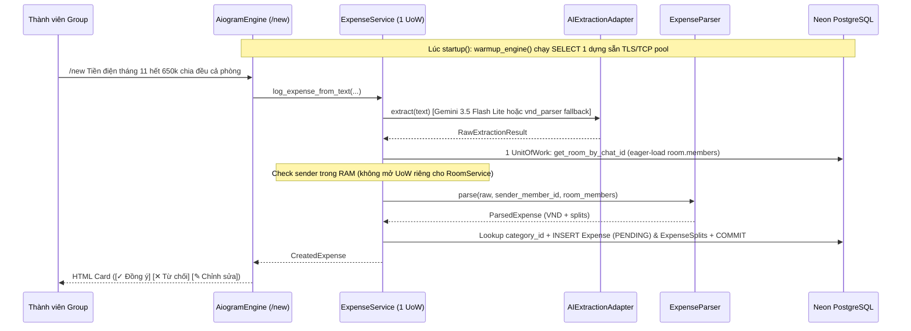

# Subtask 3 Plan & Implementation Report: Telegram Bot `/new`, UC01/UC03b & Benchmark (`SCRUM-123`)

## 1. Mục tiêu
Triển khai luồng chính của **UC01** (Ghi nhận chi tiêu chung qua tin nhắn tiếng Việt) và **UC03b** (Phân tích ý định & chia tiền) theo kiến trúc phân tầng:
`AiogramEngine (/new)` -> `ExpenseService` -> `AIExtractionAdapter (Gemini / vnd_parser)` -> `ExpenseParser` -> PostgreSQL (`PENDING`) -> **Inline Confirmation Card** (`[✓ Đồng ý]`, `[✕ Từ chối]`, `[✎ Chỉnh sửa]`).

---

## 2. Giới hạn kỹ thuật & Đề xuất dùng lệnh `/new` (Technical Limitation & Trade-off)
Mặc dù kịch bản UC01 gốc mô tả việc người dùng nhắn tin tự do trong group, nhóm áp dụng cú pháp **`/new [nội dung chi tiêu]`** (ví dụ: `/new Đi chợ 150k chia tao với Nam`) vì 2 giới hạn kỹ thuật thực tế:

1. **Telegram Group Privacy Mode:** Mặc định Telegram Bot bật Privacy Mode nên chỉ nhận được các lệnh bắt đầu bằng `/` (trừ khi chủ nhóm cấp quyền Admin cho bot hoặc tắt Privacy Mode trên `@BotFather`). Dùng `/new` giúp bot hoạt động ngay trong mọi nhóm mà không cần quyền đọc toàn bộ hội thoại riêng tư.
2. **Chi phí, độ trễ & tránh false-positive với Gemini API:** Nếu bot đọc mọi tin nhắn thường trong nhóm (*"tối nay ăn gì?"*, *"ok"*...), hệ thống sẽ gửi hàng loạt request dư thừa tới Gemini API và tăng rủi ro nhận diện nhầm. Dùng `/new` đảm bảo chỉ gọi `AIExtractionAdapter` khi thành viên chủ đích ghi chi tiêu.

> **Lưu ý:** Toàn bộ phần văn bản sau `/new` vẫn là tiếng Việt tự nhiên và được truyền thẳng từ `AIExtractionAdapter` (`RawExtractionResult`) vào `ExpenseParser.parse()` không qua lớp bọc trung gian.

---

## 3. Danh sách lệnh Telegram Bot (`TROMATE_BOT_COMMANDS`)

| Lệnh | Nguồn | Phạm vi | Mô tả chức năng |
| :--- | :--- | :--- | :--- |
| `/start` | Có sẵn (`main`) | `all` | Khởi động bot & mở liên kết TroMate Mini App |
| `/help` | Có sẵn (`main`) | `all` | Xem hướng dẫn sử dụng toàn bộ bằng tiếng Việt & ví dụ `/new` |
| `/app` | Có sẵn (`main`) | `all` | Mở nhanh giao diện TroMate Mini App |
| `/balance` | Có sẵn (`main`) | `group` | Xem số dư phòng *(mock spike hiện tại; `DebtEngine` thuộc SCRUM-125)* |
| **`/new`** | **Mới (`SCRUM-123`)** | `group` | **Ghi nhận chi tiêu mới bằng tiếng Việt tự nhiên** (vd: `/new Đi chợ 150k chia tao với Nam`) |

---

## 4. Đồng bộ với Tài liệu UI Design (`SCRUM-121` — `UI Design.docx`)

1. **Nhãn trạng thái & 3 nút Inline Card (§2.1):**
   - Trạng thái hiển thị: `Chờ xác nhận` (và `Chờ xác nhận (Duyệt thủ công — BR02)` khi `review_deadline` là `None`).
   - 3 nút bấm: **`[✓ Đồng ý]`** (`expense:agree:<id>:<version>`), **`[✕ Từ chối]`** (`expense:reject:<id>:<version>`), **`[✎ Chỉnh sửa]`** (deep-link Mini App `?startapp=expense_<id>`). *(Xử lý callback vote/edit thuộc SCRUM-124).*
2. **Quy tắc hấp thụ phần dư `Total % N` (§2.5.3):**
   - Nếu **Payer nằm trong danh sách chia** -> toàn bộ phần dư (`Total % N`) cộng cho **Payer**.
   - Nếu **Payer không nằm trong danh sách chia** -> sắp xếp thành viên theo `display_name` (A -> Z) và cộng phần dư cho người đứng đầu.
   - Đảm bảo `share_amount > 0` cho mọi thành viên (`BR05`) và `sum(share_amount) == total_amount`.
3. **Duyệt thủ công không countdown (`BR02`):**
   - Áp dụng cho cả **`Rent`** lẫn **`Utilities`** (tiền điện, tiền nước, hóa đơn nước): `review_window_minutes = None`, `review_deadline = None`.
   - Các chi tiêu ăn uống / đi chợ (`Groceries`, `Food & Drinks`...) áp dụng `BR03` với `review_timeout_minutes` của phòng (mặc định 5 phút).

---

## 5. Tối ưu hiệu năng & Luồng xử lý (`Single UoW` + `SELECT 1` Warmup)

---

## 6. Kết quả đo hiệu năng & Bóc tách từng thành phần (Neon PostgreSQL + `AiogramEngine`)

Đo thực tế bằng bài test E2E nối trực tiếp tới Neon PostgreSQL (`neondb`, Singapore pooler) với `SELECT 1` warm-up lúc khởi động (`1,278.738 ms`):

### 6.1. Bóc tách luồng `/new` (từ Telegram `Update` -> `ExpenseService` -> Neon DB -> HTML Card)

| Thành phần | Run 1: `/new` Fallback (`Groceries`, BR03) | Run 2: `/new` Gemini (`Utilities`, BR02) | Run 3: `/new` Fallback (Warm Pool, `Food & Drinks`) |
| :--- | ---: | ---: | ---: |
| **1. `AIExtractionAdapter.extract`** | `0.254 ms` | **`1,337.074 ms`** | `0.066 ms` |
| **2. `Room + Member` Check (1 UoW / RAM)** | `526.184 ms` | `428.931 ms` | `515.459 ms` |
| **3. `ExpenseParser.parse` (CPU)** | `0.192 ms` | `0.090 ms` | `0.041 ms` |
| **4. `Category + Expense` Write (1 UoW)** | `477.297 ms` | `587.150 ms` | `471.716 ms` |
| **5. Card HTML + Inline Keyboard** | `0.142 ms` | `0.104 ms` | `0.161 ms` |
| **6. `Aiogram` Router Overhead** | `0.469 ms` | `0.357 ms` | `0.401 ms` |
| *Tổng DB Neon (2 + 4)* | *`1,003.481 ms`* | *`1,016.081 ms`* | *`987.176 ms`* |
| **TỔNG E2E (`/new` -> sẵn sàng gửi Card)** | **`1,004.537 ms`** | **`2,353.706 ms`** | **`987.845 ms`** |

*(So sánh trước tối ưu 2 `UnitOfWork` + Cold Pool: `/new` Fallback tốn `2,777.402 ms` và Gemini tốn `3,070.857 ms` — sau tối ưu 1 `UnitOfWork` + `SELECT 1` warm-up, phần DB giảm gần 50% từ ~`2,002 ms` xuống ~`987–1,016 ms`)*.

### 6.2. Các lệnh nhẹ (`/start`, `/help`, `/app`, `/balance`) — Trung bình 10 lượt trên `AiogramEngine`

| Lệnh | Text Builder (CPU) | Router + Keyboard | Tổng xử lý Backend (avg) | Lần đầu (`1st`) |
| :--- | ---: | ---: | ---: | ---: |
| `/start` (private) | `0.15 µs` | `0.1181 ms` | **`0.1183 ms`** | `0.3454 ms` |
| `/start` (group) | `0.34 µs` | `0.2513 ms` | **`0.2517 ms`** | `0.1087 ms` |
| `/help` | `0.24 µs` | `0.1195 ms` | **`0.1197 ms`** | `0.1298 ms` |
| `/help@tromate_bot` | `0.24 µs` | `0.1382 ms` | **`0.1385 ms`** | `0.1441 ms` |
| `/app` (group) | `0.00 µs` | `0.2100 ms` | **`0.2100 ms`** | `0.1890 ms` |
| `/balance` (mock) | `4.12 µs` | `0.3187 ms` | **`0.3228 ms`** | `0.2614 ms` |

* **Độ trễ mạng tham chiếu tới `api.telegram.org` (`getMe`, HTTP 200):** **`804.86 ms`**. Do đó tổng thời gian từ lúc user nhắn `/help` hoặc `/start` đến khi Telegram nhận tin phản hồi vào khoảng **~`805 ms`** (chủ yếu là network RTT tới Telegram).
