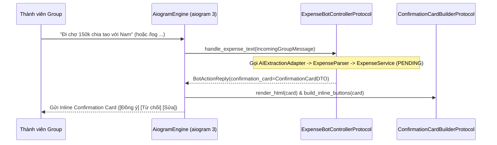

# Subtask 3 Plan: Telegram Bot Commands & Interface Specification (`SCRUM-123`)

## 1. Mục tiêu
Định nghĩa đầy đủ tập lệnh Bot Telegram, quy tắc phân luồng tin nhắn nhóm (slash commands vs tin nhắn chi tiêu tự nhiên), cấu trúc **Inline Confirmation Card**, và hợp đồng giao tiếp (`Protocol`) giữa lớp vận chuyển `aiogram 3` (`src/backend/app/bots/`) và tầng nghiệp vụ `Services`.

> **Phạm vi Subtask 3 hiện tại:** Chỉ chốt thiết kế và interface tại [interface.py](file:///src/backend/app/bots/interface.py), chưa cài đặt logic xử lý webhook cụ thể.

---

## 2. Danh sách lệnh Telegram Bot (`TROMATE_BOT_COMMANDS`)

| Lệnh | Phạm vi (`scope`) | Mô tả chức năng | Ví dụ sử dụng |
| :--- | :--- | :--- | :--- |
| `/start` | `all` (Private & Group) | Khởi động bot, đăng ký phòng/thành viên và hiển thị nút mở TroMate Mini App | `/start` |
| `/help` | `all` | Hiển thị hướng dẫn cú pháp lệnh và ví dụ nhắn ghi chi tiêu tự nhiên | `/help` |
| `/app` | `all` | Mở nhanh giao diện TroMate Mini App | `/app` |
| `/balance` | `group` | Xem tóm tắt công nợ ròng hiện tại giữa các thành viên trong phòng | `/balance` |
| `/log` | `group` | Ghi nhận chi tiêu mới một cách tường minh (ngoài luồng tự động nhận diện text tự nhiên) | `/log Đi chợ 150k chia tao với Nam` |
| `/pending` | `group` | Liệt kê các khoản chi tiêu đang ở trạng thái `PENDING` chờ xác nhận | `/pending` |

---

## 3. Quy tắc định tuyến tin nhắn nhóm (`Message Routing Rules`)

Khi nhận được `Update.message` từ group/supergroup (`chat.type in {"group", "supergroup"}`):
1. **Slash Commands (`/start`, `/help`, `/app`, `/balance`, `/log`, `/pending`):**
   - Được bắt bởi `aiogram.filters.Command(...)` trước các handler text thông thường.
   - Riêng `/log <nội dung>`: bóc bỏ prefix `/log` (và `@bot_username` nếu có) rồi chuyển phần text còn lại vào `ExpenseBotControllerProtocol.handle_expense_text(...)`.
2. **Natural-Language Group Text (`F.text & ~F.text.startswith("/")`):**
   - Bỏ qua tin nhắn từ bot (`message.from_user.is_bot`).
   - Chuyển `IncomingGroupMessage` vào `ExpenseBotControllerProtocol.handle_expense_text(...)`.
   - Nếu không trích xuất được chi tiêu (chat thông thường như *"tối nay ăn gì?"*), controller trả về `None` và bot **im lặng** để không làm phiền nhóm.
   - Nếu trích xuất thành công và lưu DB ở trạng thái `PENDING`, bot gửi trả **Inline Confirmation Card** reply vào tin nhắn gốc.

---

## 4. Inline Confirmation Card & Callback Schema (UC01 / UC05)

### Cấu trúc nút bấm (Inline Keyboard)
| Nút hiển thị | Loại nút | Giá trị (`callback_data` / `url`) | Ghi chú |
| :--- | :--- | :--- | :--- |
| `[✅ Đồng ý]` | `callback_data` | `expense:agree:<expense_id>:<version>` | Khớp tối đa 64 bytes của Telegram (36 + 15 + version <= 56 bytes) |
| `[❌ Từ chối]` | `callback_data` | `expense:reject:<expense_id>:<version>` | Có kèm `version` để chống stale click (optimistic locking 409) |
| `[✏️ Sửa]` | `url` / `web_app` | Mini App deep link `?startapp=expense_<id>` | Mở Mini App để chỉnh sửa chi tiết |

---

## 5. Luồng tích hợp dự kiến (`AiogramEngine` -> `ExpenseBotControllerProtocol`)

---

## 6. Giao diện Python đã định nghĩa
Xem chi tiết đầy đủ tại `src/backend/app/bots/interface.py`:
- Command specs: `BotCommandSpec`, `TROMATE_BOT_COMMANDS`
- Callback helpers: `build_agree_callback`, `build_reject_callback`, `build_edit_callback`
- DTOs: `IncomingGroupMessage`, `SplitLineDTO`, `ConfirmationCardDTO`, `BotActionReply`
- Protocols: `ConfirmationCardBuilderProtocol`, `ExpenseBotControllerProtocol`
