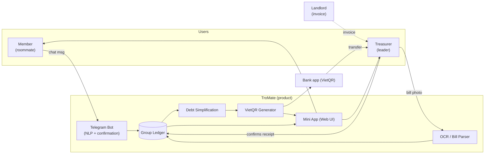

# TroMate — Vision Document

**Version 1.0**

> ⚠️ **Template note — remove this box before submission.**
> The PA1 brief references a *Vision* `.docx` template on Moodle that was not available in the repository. This file reconstructs the standard **RUP "Vision"** outline and attempts every section, as required by PA1. Before submitting, reconcile the heading numbers/names with the official Moodle template, then export to `.docx` in **Times New Roman, size 10**, removing the `[blue italic]` guidance text.
> Items marked **[CONFIRM]** are assumptions the team must verify.

Group: 06 &nbsp;·&nbsp; Date: 15/10 &nbsp;·&nbsp; Document identifier: TroMate-Vision-v1.0

---

## Revision History

| Date | Version | Description | Author |
|---|---|---|---|
| 15/10 | 1.0 | Initial version: vision of the product for the Inception phase (PA1) | TroMate team |

---

## 1. Introduction

### 1.1 Purpose

This document defines the **vision** for **TroMate**, a chatbot and companion Mini App that acts as the automatic "chief accountant" for shared housing. It captures *what* the product must do and *why* — the problem, the target users, the product's positioning, its high-level features, and the non-functional qualities it must meet. It is the reference from which the Software Development Plan and, later, the Software Requirements Specification (SRS) and use-case model derive. It is written for the **TroMate team**, the **course Teaching Assistant (TA)**, and any later reader who needs to understand the product's intent.

### 1.2 Scope

This vision describes the **MVP** for the TroMate product as it will be built within this course. The product is a **Telegram bot + embedded Mini App (zero-install)** that:

- logs shared expenses from **natural-language chat messages**,
- reads **rent bills and meter photos** via OCR,
- **minimizes circular debts** across the members, and
- settles debts with **dynamic VietQR** codes confirmed by the treasurer.

*Out of scope for this release:* direct **Zalo** integration (subject to Zalo's API policy) and any **automated transfer execution** (settlement is confirmed manually by the treasurer). Features such as the chore scheduler, room fund, and move-in checklist are recognised but deferred to a future backlog.

### 1.3 Definitions, Acronyms, and Abbreviations

| Term | Definition |
|---|---|
| **Vision** | This document — the high-level product definition and motivation |
| **SDP** | Software Development Plan |
| **SRS** | Software Requirements Specification |
| **MVP** | Minimum Viable Product |
| **RUP** | Rational Unified Process — the process framework followed in this course |
| **NLP** | Natural Language Processing — parsing chat messages into ledger entries |
| **OCR** | Optical Character Recognition — reading rent bills and meter photos |
| **Mini App** | A web application embedded inside Telegram, requiring no separate install |
| **Treasurer** | The roommate who pays the landlord, collects money and confirms receipts |
| **VietQR / NAPAS** | Vietnam's national QR payment standard used to build exact-amount transfers |
| **Ledger** | The room's record of all shared expenses and resulting balances |
| **TA** | Teaching Assistant |
| **PII** | Personally Identifiable Information |
| **NFR** | Non-functional Requirement |
| **UI/UX** | User Interface / User Experience |

### 1.4 References

| Ref | Document | Location |
|---|---|---|
| R1 | TroMate Project Proposal (PA0) — problem, users, survey evidence | `pa/PA0/project-proposal.md` |
| R2 | TroMate Software Development Plan (SDP) | `pa/PA1-Group06/project-plan/software-development-plan.md` |
| R3 | Course vision template (RUP *Vision*) | Moodle |
| R4 | User survey (Google Form) & responses | Google Forms / Sheets (see R1 §6) |
| R5 | Source code & documentation repository | https://github.com/AmnO-O/TroMateProject |
| R6 | Task & sprint board (Jira) | https://apcs24-cs300.atlassian.net/jira |

### 1.5 Overview

The remainder of this document is organised as follows: **Section 2** positions the product (opportunity, problem, position statement). **Section 3** describes the stakeholders and users and their needs. **Section 4** gives a product overview. **Section 5** lists the product features. **Sections 6–10** capture constraints, quality ranges (non-functional requirements), priority, other requirements and documentation needs. **Section 11** is the glossary.

---

## 2. Positioning

### 2.1 Business Opportunity

Shared living multiplies small, recurring money events: daily groceries, drinking water, WiFi, cleaning supplies, and a monthly rent invoice full of variable charges. The people involved — students and young professionals — already organise their lives inside group chats (Telegram/Zalo) but **do not want to install yet another app** to track a few tens of thousands of đồng. TroMate removes that friction by living **where the conversation already happens**, turning natural chatter and a photo of the rent bill into a clean ledger and a one-tap settlement. There is no dominant Vietnam-first tool that combines **natural-language logging, bill OCR, debt netting and VietQR** in one zero-install experience.

### 2.2 Problem Statement

| | |
|---|---|
| **The problem of** | tracking and settling shared living expenses |
| **affects** | roommates in shared rentals and dormitories, especially the person who acts as "room treasurer" |
| **the impact of which is** | fragmented micro-debts are forgotten, the monthly rent bill is manually recomputed and offset against advances (slow and error-prone), circular debts make settlement annoying, and roommates feel awkward asking each other for money |
| **a successful solution would** | make logging an expense effortless (a chat message or a bill photo), keep every balance accurate, cancel circular debt chains so the fewest transfers are needed, and let members settle to the exact đồng in one tap |

Evidence (survey, n = 9, see R1 §6): every core capability was rated **≥ 3.78 / 5**, with **debt simplification (4.22)** and **natural-language logging (4.11)** strongest; the top adoption blocker is **fear of data leakage — 67%**.

### 2.3 Product Position Statement

| | |
|---|---|
| **For** | roommates (students and young professionals) sharing a rented room or dormitory |
| **Who** | need to track shared spending and settle monthly rent without extra effort or awkwardness |
| **The product** | **TroMate** is a chatbot + Mini App "chief accountant" |
| **That** | logs expenses from chat messages, reads rent bills by OCR, minimizes circular debts, and settles them with VietQR |
| **Unlike** | spreadsheets, notes apps, and general expense apps that require manual entry and a separate install |
| **Our product** | lives inside the group chat the roommates already use, is zero-install, Vietnam-first (Vietnamese copy, VietQR/NAPAS, đồng), and is explicit about data privacy |

---

## 3. Stakeholder and User Descriptions

### 3.1 Market Demographics

The target market is **shared housing in Vietnam**: students and young professionals renting a room or small apartment with **2–5 people**. They are smartphone-first, already heavy users of **Telegram and Zalo** group chats, and are price-sensitive (free tools preferred). Survey mix (n = 9): **5/9 rented with friends, 3/9 dormitory, 1/9 lived with family**. The market is highly seasonal (new tenancies each semester), and word-of-mouth within a room is the natural adoption path.

### 3.2 Stakeholder Summary

| Stakeholder | Represents | Role in the product |
|---|---|---|
| **Roommates (Members)** | Primary users | Log shared expenses, view balances, settle their debts |
| **Treasurer (group leader)** | Primary user and payer | Receives the rent bill, pays the landlord, uploads the bill, confirms receipt of payments |
| **Landlord / property manager** | Indirect stakeholder | Issues the rent invoice that TroMate parses (input only) |
| **Product team (Group 06)** | Developers | Elicit needs, build, test and maintain the product |
| **Course TA / instructor** | Sponsor / evaluator | Reviews the project and grades the deliverables |
| **Telegram** | Platform provider | Hosts the bot channel and the Mini App runtime |
| **VietQR / NAPAS & member banks** | External system providers | Provide the QR payment rails and the banking apps members transfer from |

### 3.3 User Summary

| User | Description | Responsibilities | Skill level |
|---|---|---|---|
| **Member (roommate)** | Student or young professional sharing a room; low tolerance for friction; may be non-technical | Logs shared expenses by chat; checks who-owes-whom; settles debts | Basic smartphone user |
| **Treasurer (group leader)** | The member who handles the money each month | Pays the landlord; uploads the rent bill photo; verifies OCR values; confirms payments received | Comfortable mobile user |
| **Landlord** | Property owner/manager | Provides the invoice; no direct interaction with the app | — |

**Persona 1 — "Nam, the member."** Nam shares a 3-person room. He buys water and detergent for the group and forgets to write it down. He wants to message the group and have the expense remembered *for* him, and to see a trustworthy balance without opening a spreadsheet.

**Persona 2 — "Hào, the treasurer."** Hào collects the rent each month and pays the landlord. He dreads recomputing the handwritten bill and chasing everyone for transfers. He wants to photograph the bill, correct the numbers once, and send each roommate an exact VietQR — then just confirm when the money lands.

### 3.4 Key Stakeholder or User Needs

| Need | Priority | Concern | How the product addresses it |
|---|---|---|---|
| Log a shared expense with almost no effort | High | Opening an app/sheet is too much friction | Natural-language parsing of chat messages (rated 4.11/5) |
| Avoid circular, messy debts | High | Multiple back-and-forth transfers | Debt-simplification (minimum cash flow) engine (rated 4.22/5) |
| Read the rent bill without manual math | High | Handwritten invoices, many variables | OCR extraction with a human review screen; offsets advances |
| Settle to the exact đồng in one tap | High | Wrong/rounded amounts, awkward reminders | Dynamic VietQR with amount + note pre-filled (rated 4.00/5) |
| Trust that data stays private | High | 67% fear data leakage — the #1 blocker | Explicit consent, data minimisation, deletion, retention note |
| See where the money went | Medium | No visibility into monthly spend | Monthly expense report (rated 3.78/5) |
| Verify the landlord's meter readings | Medium | Suspected over-charging | Meter scanner cross-check (rated 3.78/5) |
| Remind debtors without awkwardness | Medium | Embarrassment asking for money | Polite/meme reminders after the 24-hour cutoff |
| Use it without installing anything | High | Install friction blocks adoption | Telegram bot + Mini App (zero-install) |

### 3.5 Alternatives and Competition

| Alternative | Why it falls short |
|---|---|
| **Remembering it / notes app** | Forgotten entries; no balances; no splitting (survey: 4/9 rely on memory) |
| **Group chat + calculator** | Manual; no ledger; no netting; no QR |
| **Google Sheets / Excel** | Must be opened and edited by hand; error-prone for the rent bill |
| **General expense apps (e.g. Splitwise, Money Lover)** | Require a separate install and manual entry; not Vietnam-first (no VietQR, no bill OCR); no chat-native logging |
| **Letting the landlord's numbers stand** | No cross-check of meter readings; no offsetting of member advances |

---

## 4. Product Overview

### 4.1 Product Perspective

TroMate is a **new, self-contained product** that integrates with, rather than replaces, existing tools. It sits on top of the roommates' existing Telegram group chat and connects to VietQR/NAPAS for payment. It is not an extension of an existing system. The diagram below shows the product in context.

### 4.2 Summary of Capabilities

| Capability | Description | Benefiting users |
|---|---|---|
| Natural-language expense logging | Turn a chat message into a structured, editable expense | Members |
| Confirmation & auto-commit workflow | Expenses are proposed as `PENDING` and require Agree / Reject / Edit; auto-commit after 60 s | Members |
| Rent bill OCR | Extract base rent, electricity/water readings and surcharges from a photo | Treasurer |
| Meter scanner | Cross-check hallway meter readings against the landlord's bill | Treasurer |
| Usage anomaly detection | Flag consumption spikes against a recent baseline | Members |
| Debt simplification | Cancel circular debts to minimize the number of transfers | All |
| VietQR settlement | Per-member QR with exact amount and note; treasurer confirms receipt | All |
| Polite meme reminders | Nudge unsettled members after 24 hours without awkwardness | Treasurer |
| Monthly report | Visual end-of-month breakdown and per-person average | All |
| Mini App / Web UI | Dashboard, ledger, settlement and report screens, zero-install | All |

### 4.3 Assumptions and Dependencies

**Assumptions.**
- Roommates already use a Telegram group chat to communicate.
- Users are willing to grant the bot message access and to send bill photos in the group.
- Members can learn the required technologies during the project.

**Dependencies.**
- **Telegram Bot API** and **Telegram Mini App** runtime remain available and permit the intended use.
- **VietQR / NAPAS** generation remains available through a public library/service; a member's bank app supports VietQR.
- **OCR/NLP** services or libraries are available on the free tier.
- **Zalo** integration depends on Zalo's API access policy (deferred).

### 4.4 Cost and Pricing

TroMate is developed as a **free, non-commercial course project**. There is **no charge** to users; development relies on **free tiers** (GitHub, Jira, free-tier hosting/database, Telegram APIs). `[CONFIRM]` whether the Mini App will be published publicly or kept in a test workspace.

### 4.5 Licensing and Installation

*Zero-install.* Users do not install an application: they add the **TroMate bot** to an existing Telegram group and open the **Mini App** from within Telegram. There is no physical media, licence key, or packaging. `[CONFIRM]` the open-source licence for the repository (e.g. MIT) if the source is to be published.

---

## 5. Product Features

> The features below are the **high-level product features** required by PA1. Detailed behaviour and acceptance criteria are elaborated into the SRS and use cases during Elaboration.

**F1 — Natural-language expense logging.** A member writes an everyday message (e.g. *"mua nước 50k chia 3"*). The bot parses the amount, payer, beneficiaries and description, defaults to an equal split, and proposes an **editable** expense. The beneficiary list is always shown and editable so the wrong people are never silently charged.

**F2 — Confirmation & auto-commit workflow.** Each proposed expense enters a `PENDING` state that members may **Agree / Reject / Edit**. If no one objects, it **auto-commits after 60 seconds**; rejection freezes the expense for correction. This keeps the ledger accurate without requiring everyone to act.

**F3 — Rent bill OCR & itemized parsing.** The treasurer sends a photo of the rent invoice. OCR extracts the **base rent, previous/current electricity readings, unit price, water usage, and surcharges**. Extracted values are shown for **human review** and are written to the ledger **only after approval**, since OCR can misread handwritten or faint bills.

**F4 — Meter scanner.** The treasurer photographs the room's electricity/water meters; the bot recognises the digits and **cross-checks** them against the landlord's invoice, flagging mismatches.

**F5 — Usage anomaly detection.** Consumption is compared against a recent baseline; unusual spikes are flagged (possible leaks or faulty meters).

**F6 — Debt simplification.** The bot solves the **minimum cash flow** problem on the group's debt graph, cancelling circular debts and minimising the number of transfers.

**F7 — VietQR settlement.** For each outstanding debt, the bot generates a **dynamic VietQR (NAPAS)** code with the exact amount and a standardised note pre-filled. *Scanning is not paying*: a transfer moves the debt to **awaiting receipt confirmation**, and the **treasurer confirms receipt** to clear it — clearing only that obligation, not the member's whole balance.

**F8 — Polite meme reminders.** After a **24-hour** settlement cutoff, the bot nudges members who have not paid using friendly/meme messages, easing the awkwardness of asking for money.

**F9 — Monthly expense report.** A visual end-of-month breakdown: electricity and water usage, shared food costs, average living cost per person, and trends against previous months.

**F10 — Mini App / Web UI.** The rich interface opened from Telegram: **dashboard** (balances and who-owes-whom), **ledger/history**, **rent-bill review**, **settlement**, and **monthly report** screens — with admin edit/delete and group settings.

*Deferred to a future backlog (not in this release):* chore & trash scheduler, shared room fund ledger, and move-in asset/deposit checklist.

---

## 6. Constraints

| Type | Constraint |
|---|---|
| **Schedule** | Delivered over the course duration as **5 two-week sprints** across 3 phases (see SDP §4.2) |
| **Staff** | Exactly **5 team members**, no external support |
| **Budget** | Effectively **zero** — free tiers only |
| **Platform** | Telegram Bot API + Mini App; Zalo deferred; payments via VietQR/NAPAS |
| **Privacy** | Must honour data consent and minimisation; the top adoption blocker is data-leakage fear (67%) |
| **Language** | Vietnamese primary copy, English subtitle |
| **Scope** | No automated transfer execution; settlement confirmed manually |
| **Regulatory** | Handle personal data in line with Vietnam's personal-data-protection rules (Decree 13/2023/ND-CP) `[CONFIRM]` |

---

## 7. Quality Ranges

Non-functional requirements, expressed as measurable ranges. `[CONFIRM]` the numeric targets with the team.

| Quality attribute | Measure | Min | Target | Max |
|---|---|---|---|---|
| **Privacy & consent** | PII collected beyond an expense's own fields | 0 unnecessary fields | Deletable entries + stated retention | — |
| **Ease of logging** | Time from message to saved entry, no install | — | ≤ 10 s | — |
| **Parsing latency** | Bot reply for a chat expense | — | ≤ 2 s | ≤ 5 s |
| **OCR turnaround** | Bill photo → fields shown | — | ≤ 5 s | ≤ 10 s |
| **OCR accuracy** | Correct fields on clearly printed bills | 90 % | 95 % | — |
| **Money correctness** | Errors in computed balances | — | 0 (review + confirmation gate) | — |
| **Usability** | Non-technical users logging unaided on first try | 7 / 10 | 9 / 10 | — |
| **Localization** | Screens with Vietnamese + English copy | 100 % | 100 % | — |
| **Availability** | Core features reachable (free tier) | 95 % | 99 % | — |
| **Portability** | Supported clients | Android, iOS, desktop | + Telegram WebView | — |
| **Scalability** | Members per room supported | 2 | 3–5 | 10 |

---

## 8. Precedence and Priority

Priorities follow **MoSCoW**. They may be revised during Elaboration as the architecture solidifies.

| Priority | Features |
|---|---|
| **Must have** | F1 Natural-language logging · F2 Confirmation workflow · F3 Rent bill OCR · F6 Debt simplification · F7 VietQR settlement · F10 Mini App (dashboard, ledger, settlement) |
| **Should have** | F4 Meter scanner · F8 Meme reminders · F9 Monthly report |
| **Could have** | F5 Usage anomaly detection · chore scheduler · room fund · move-in checklist |
| **Won't have (this release)** | Zalo integration · automated bank transfers · multi-currency · advanced split rules beyond equal/custom |

---

## 9. Other Product Requirements

### 9.1 Applicable Standards

- **EMV® QR Code Specification** as implemented by **VietQR / NAPAS** for payment codes.
- **Telegram Bot API** and **Telegram Mini App (Web App)** guidelines.
- **UTF-8 / Unicode** for Vietnamese text; **ISO 8601** for dates.
- Vietnam **Decree 13/2023/ND-CP** on personal data protection (privacy) `[CONFIRM]`.

### 9.2 System Requirements

- A **Telegram account** and the Telegram app (mobile or desktop) with a modern **WebView** for the Mini App.
- A **bank app** that scans **VietQR** for settlement.
- Backend: a web service with an **OCR/NLP** pipeline and a **database** for the ledger (technology TBD — see SDP §4.1); free-tier hosting.

### 9.3 Performance Requirements

See Section 7. In summary: parsing ≤ 2 s (target), OCR ≤ 5 s (target), availability ≥ 99 % (target), correct balances at all times.

### 9.4 Environmental Requirements

- **Mobile-first**; must work on mid-range Android devices and within the Telegram WebView.
- Must function on **low-bandwidth** connections common in shared housing.
- No special hardware; uses the phone's existing camera for bill/meter photos.

---

## 10. Documentation Requirements

| Document | Audience | Purpose |
|---|---|---|
| **User guide** | Members & treasurer | How to log expenses, review bills and settle debts |
| **Treasurer/admin guide** | Treasurer | Bill upload, OCR review, receipt confirmation, group settings |
| **Data-handling & privacy note** | All users | What is stored, for how long, and how to delete it |
| **Developer documentation** | Team | Architecture, data model and API notes (from Elaboration onward) |

---

## 11. Glossary

| Term | Meaning |
|---|---|
| **Member** | A roommate who participates in the group ledger |
| **Treasurer** | The member who pays the landlord and confirms receipts |
| **Ledger** | The room's record of shared expenses and balances |
| **Quick split** | Logging an expense from a natural-language message |
| **Netting / Debt simplification** | Cancelling circular debts to minimise transfers |
| **VietQR** | Vietnam's NAPAS QR payment standard |
| **OCR** | Optical Character Recognition — reading text from photos |
| **NLP** | Natural Language Processing — understanding chat text |
| **Mini App** | Zero-install web app opened inside Telegram |
| **PENDING** | A proposed expense awaiting Agree / Reject / Edit before it auto-commits |
| **Meme reminder** | A friendly image nudge sent to unsettled members |
| **Advance** | Money a member has already fronted for the group |
