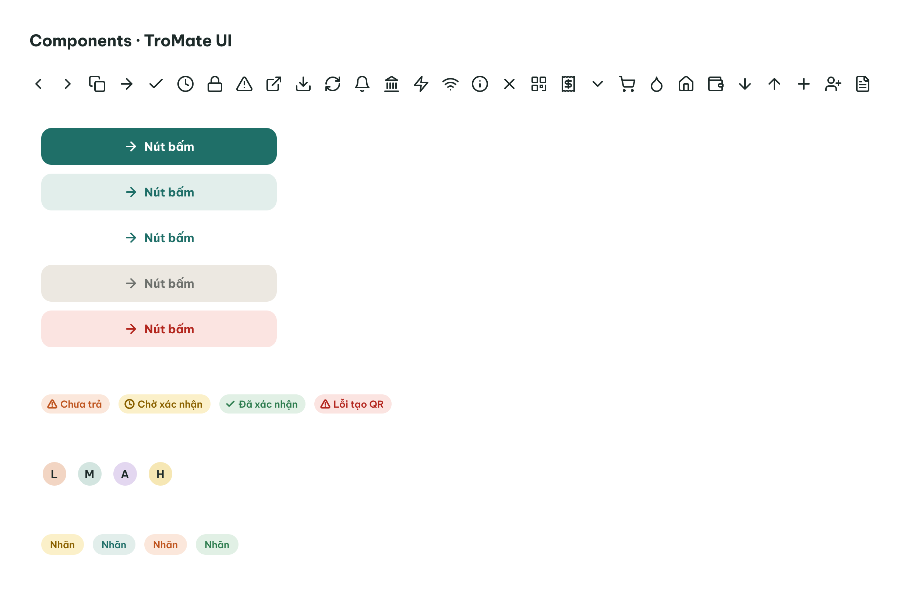
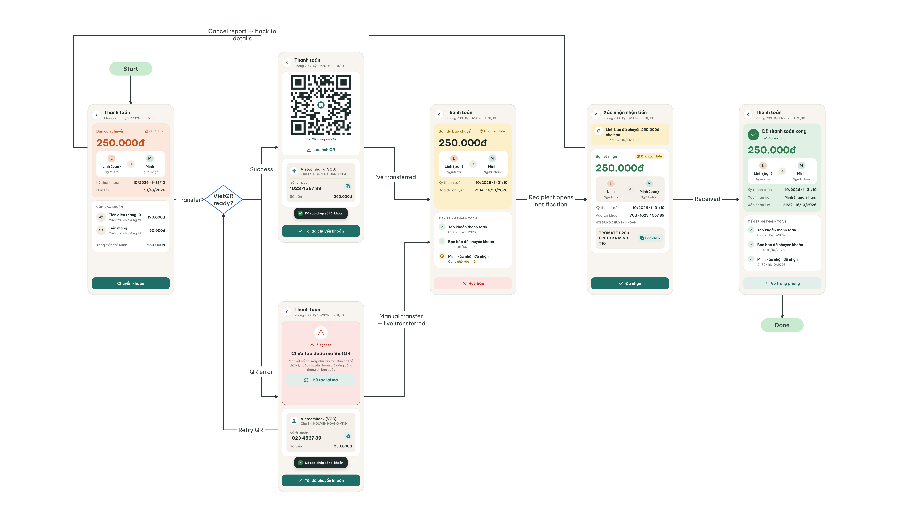
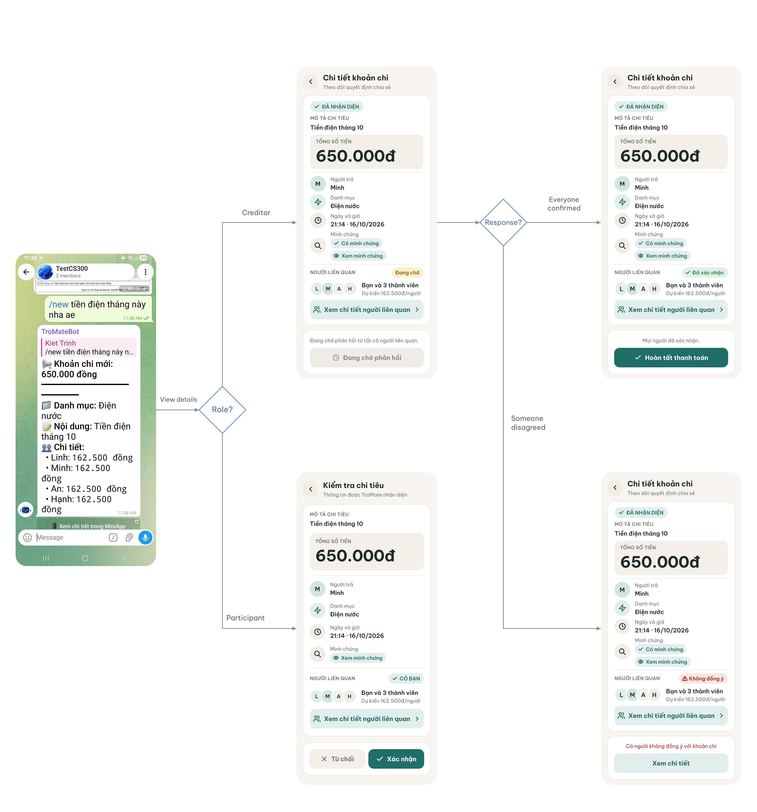
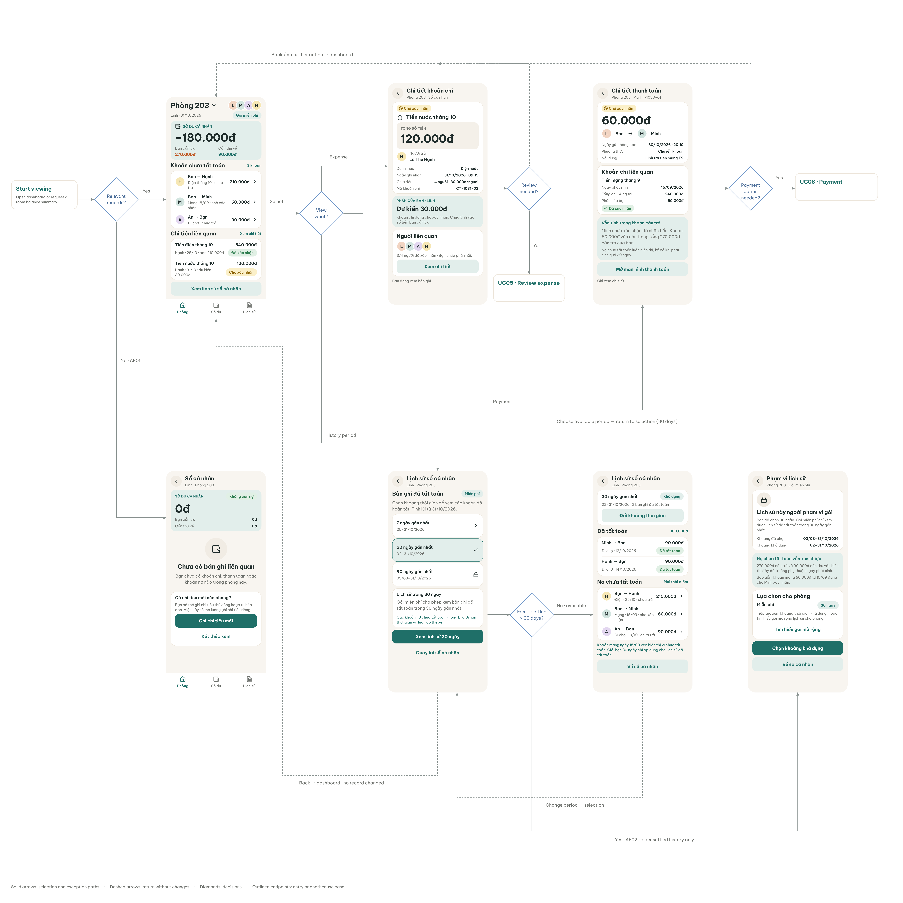

# TroMate — UI Technical Detail Specification (Inception Phase / PA1)

* **Project:** TroMate — Telegram Roommate Expense & Rent Reconciliation Bot
* **Jira Task:** [SCRUM-97 (Update UI Prototyping)](https://apcs24-cs300.atlassian.net/browse/SCRUM-97)
* **Course Deliverable:** Section `e -- UI Prototyping (5 points)`
* **Author:** TroMate Team
* **Date:** October 31, 2026

> **Prototype Demonstration Notice:**  
> This document is a simple prototype to demonstrate the UI and interaction flows of the TroMate application. For complete and detailed use-case specifications (including full business rules, actor definitions, preconditions, and postconditions), please see [Use Case Specification](../use-case-specification/usecase-specification.docx)).

---

# PART 1: UI DESIGN SYSTEM & COMPONENT LIBRARY

The TroMate interface is architected for mobile viewports as a Telegram Mini App (TMA), seamlessly integrated with the Telegram group chatbot ecosystem.

### 1.1 Core Design Principles
1. **Stress-Free Financial Experience:** Warm off-white canvas (`#F8F5F0`), soft rounded cards (`20px–22px`), and respectful language ("Room is in balance", "Pending confirmation") to mitigate interpersonal debt tension.
2. **Single Primary CTA per View:** Each view provides exactly one high-contrast Primary action to prevent mistaken transfers or erroneous approvals.
3. **Triad Status Feedback:** Every status indicator combines an **Icon + Text Label + Color Token** to ensure immediate comprehension and accessibility.
4. **Unambiguous Currency Display:** Real-time thousand-separated values (e.g., `250.000đ`, avoiding truncated slang like `250k`).

---

### 1.2 Design Tokens

#### Semantic Color Tokens

| Token Variable | Hex Code | Role & Application |
| :--- | :---: | :--- |
| `--bg-canvas` | `#F8F5F0` | Global app background (warm off-white) |
| `--bg-surface` | `#FFFFFF` | Cards, modals, bottom sheets |
| `--bg-subtle` | `#F4F0E9` | Nested containers (bank info, copy boxes) |
| `--border-default` | `#ECE5DA` | 1px card borders and horizontal dividers |
| `--brand-teal` | `#1F6F68` | Primary CTA buttons, active tabs, highlights |
| `--brand-tealSoft` | `#E2EEEB` | Secondary buttons, action chips |
| `--status-orange` | `#BF5520` | Debt warnings ("You owe", "Unpaid") |
| `--status-orangeSoft` | `#FBE7DB` | Warning card background |
| `--status-amber` | `#8A6100` | "Pending approval", "New room" |
| `--status-green` | `#2E7D4F` | "Settled", "To collect", "Period completed" |
| `--status-greenSoft` | `#E1F0E5` | Settlement success card background |
| `--status-red` | `#B3261E` | QR generation errors, rejection actions |

#### Typography & Viewport Standards
* **Typeface:** `Be Vietnam Pro` (complete Vietnamese diacritics support).
* **Line Height:** Minimum $\ge 1.3\times$ font-size to prevent diacritic clipping on mobile screens.
* **Layout Grid:** 360px base mobile width, 16px screen padding, 14px–16px card spacing.

---

### 1.3 Atomic Component Library

  

1. **Button Component (`Button`):**
   * Standard height: `50px`, border radius: `14px`, `full-width`.
   * Variants: `Primary` (Teal background, white text), `Secondary` (TealSoft background, Teal text), `Ghost` (Transparent, Teal border), `Disabled` (Muted gray `#ECE8E1`), `Danger` (Soft red).
2. **StatusChip Component (`StatusChip`):**
   * Pill badge (`padding 4px × 10px`), radius: `999px`.
   * Composed of a 14px icon + label: `Unpaid` (Alert), `Pending` (Clock), `Confirmed` (Check), `QR Error` (Alert).
3. **Avatar Component (`Avatar`):**
   * 36px circular avatar with 2px white border, displaying first initial (`L` - Linh, `M` - Minh, `A` - An, `H` - Hanh).
4. **TabBar Component (`TabBar`):**
   * Fixed bottom navigation bar with 3 items: `Room` (Home), `Balance` (Wallet), `History` (Ledger).

---

# PART 2: USER FLOWS

---

## FLOW 1: Settle Debt, Generate QR, Transfer

  

### Trigger
A room member with an unsettled payable balance (e.g., **Linh**, who owes **250.000đ** to **Minh** for October Electricity and Internet) selects an outstanding payment record from their Personal Ledger or Room Dashboard and taps the primary **"Chuyển khoản"** (Transfer) button.

### Flow (Basic + Alternative)

#### Basic Flow (Dynamic VietQR Generation & Two-Way Settlement)
1. **Debt Breakdown Review (Screen 1):** Debtor (Linh) views the payment summary: Room `Phòng 203`, billing period `10/2026 - 1-31/10`, amount `250.000đ`, and status badge `Chưa trả` (Unpaid). Displays payment direction `Linh (bạn) ➔ Minh`, due date `31/10/2026`, and itemized component breakdown (Điện tháng 10: `190.000đ`, Mạng: `60.000đ`, Total: `250.000đ`). Debtor taps **"Chuyển khoản"** (Transfer).
2. **Dynamic VietQR Display (Screen 2a):** VietQR service returns a Napas 247 dynamic QR code encoded with exact amount `250.000đ`, receiving bank `Vietcombank (VCB)`, account `1023 4567 89` (`NGUYEN HOANG MINH`), and payment memo. Payer can tap **"Lưu ảnh QR"** to save code or **"Đã sao chép số tài khoản"** to copy account info.
3. **Execution & Self-Reporting:** Debtor transfers money via external banking application, returns to TroMate, and taps **"Tôi đã chuyển khoản"** (I've transferred).
4. **Debtor Waiting State (Screen 3):** Status updates to `Bạn đã báo chuyển 250.000đ` with amber badge `Chờ xác nhận`. Audit timeline records creation (`09:02 - 15/10/2026`) and payment notification (`21:14 - 16/10/2026`).
5. **Recipient Verification (Screen 4):** Recipient (Minh) receives Telegram alert (*"Linh đã chuyển 250.000đ cho bạn lúc 21:14 - 16/10/2026"*), opens verification screen showing `Bạn sẽ nhận 250.000đ`, receiving account `VCB - 1023 4567 89`, and memo `TROMATE P203 LINH TRA MINH T10`. Minh checks bank balance and taps **"✓ Đã nhận"** (Received).
6. **Settlement Commitment (Screen 5):** Ledger commits settlement. Displays green badge `✓ Đã thanh toán xong - Đã xác nhận` (`250.000đ`, Linh ➔ Minh), confirmed by Minh at `21:32 · 16/10/2026`, with full timeline complete. Payer taps **"Về trang phòng"** to return to dashboard.

#### Alternative Flows
* **AF01: QR Generation Failure & Manual Fallback (Screen 2b):** At step 1, if dynamic VietQR generation fails, system renders red alert banner *"Lỗi tạo QR — Chưa tạo được mã VietQR"*. Debtor can tap **"Thử tạo lại mã"** (Retry QR) or manually copy bank details (`Vietcombank - 1023 4567 89`), transfer via banking app, and tap **"Tôi đã chuyển khoản"** (Manual transfer) to proceed to pending state (Screen 3).
* **AF02: Cancel Transfer Report:** At Screen 3 (Payer Waiting State), if the debtor reported prematurely or made an error, debtor taps **"✕ Huỷ báo"** (Cancel report) to cancel the pending report and return to Screen 1 without altering balances.

### Usecases Covered
* UC08 Settle Net Debt
* UC09 Generate Dynamic VietQR

---

## FLOW 2: Upload Receipt + Natural Language Message, Create new Expense, Accept/Reject

  

### Trigger
A room member (e.g., **Minh** / **Kiet Trinh**) uploads an invoice/receipt photo (e.g., an EVN electricity bill) accompanied by a natural language message (`/new tiền điện tháng này nha ae`) into the room's Telegram group chat.

### Flow (Basic + Alternative)

#### Basic Flow (Multimodal Ingestion & Consensus Confirmation)
1. **Chat Submission & AI Parsing:** Member sends bill photo with caption `/new tiền điện tháng này nha ae`. TroMate AI parses the photo and text, identifying: total `650.000đ`, category `Điện nước`, title `Tiền điện tháng 10`, and equal 4-way split (`162.500đ / person`). Bot posts summary in chat with inline CTA `[ 📱 Xem chi tiết trong MiniApp ]`.
2. **Role-Based Mini App Views:**
   * **Creditor View (Minh - Screen 2a):** Displays *Chi tiết khoản chi* with badge `✓ ĐÃ NHẬN DIỆN`, total `650.000đ`, payer `Minh`, proof link `✓ Có minh chứng`, and status `Đang chờ`. Banner displays: *"Đang chờ phản hồi từ tất cả người liên quan"* with disabled button `⏱ Đang chờ phản hồi`.
   * **Participant / Debtor View (Linh / An / Hạnh - Screen 2b):** Displays *Kiểm tra chi tiêu* with description `Tiền điện tháng 10`, total `650.000đ`, payer `Minh`, chip `✓ CÓ BẠN` (projected share `162.500đ/người`), and action buttons: **"✓ Xác nhận"** (Confirm) and **"✕ Từ chối"** (Reject).
3. **Consensus Voting:** All debtors (Linh, An, Hạnh) review details and tap **"✓ Xác nhận"** (Confirm).
4. **Finalization & Ledger Commitment (Screen 3a):** Status badge updates to `✓ Đã xác nhận`. System displays *"Mọi người đã xác nhận."* Creditor's CTA activates as **"✓ Hoàn tất thanh toán"**. Tapping commits expense to the room ledger and updates balances.

#### Alternative Flows
* **AF01: Debtor Disagreement / Rejection ("Someone disagreed" - Screen 3b):** If any participant taps **"✕ Từ chối"** (Reject) on Screen 2b, status badge turns to `⚠ Không đồng ý`, alert banner displays *"Có người không đồng ý với khoản chi"*, and CTA becomes **"Xem chi tiết"** to view reasons, discuss, or edit the draft per UC05-AF01 without altering confirmed balances.

### Usecases Covered
* UC01 Log Expense via Natural Text
* UC02 Log Expense via Receipt Photo
* UC03a Read Expense Details from an Image
* UC03b Interpret Expense Details and Split
* UC05 Confirm Reject or Edit Pending Expense

---

## FLOW 3: View Dashboard

  

### Trigger
A room member opens the TroMate Telegram Mini App from the bot or group chat, or requests a room balance summary.

### Flow (Basic + Alternative)

#### Basic Flow (Dashboard Exploration & Detailed Drill-Down)
1. **Active Dashboard Overview (Screen 1a):** Header shows `Phòng 203`, avatars (`L M A H`), badge `Gói miễn phí`, date `31/10/2026`. Net balance card displays `SỐ DƯ CÁ NHÂN: -180.000đ` (Bạn cần trả: `270.000đ`, Cần thu về: `90.000đ`). Lists *Khoản chưa tất toán* (Bạn ➔ Hạnh: `210.000đ`, Bạn ➔ Minh: `60.000đ` chờ xác nhận, An ➔ Bạn: `90.000đ`) and *Chi tiêu liên quan* (Điện T10: `840.000đ` đã xác nhận, Nước T10: `120.000đ` chờ xác nhận). TabBar: `Phòng`, `Số dư`, `Lịch sử`.
2. **Expense Detail Drill-Down (Screen 2a):** Selecting an expense (*Tiền nước tháng 10*, Code `CT-1031-02`): displays total `120.000đ`, paid by Lê Thu Hạnh, split 4 (`30.000đ/người`), your projected share `30.000đ` (with notice: *"Khoản chi đang chờ xác nhận. Chưa tính vào số tiền bạn cần trả."*), and status `3/4 người đã xác nhận`. If review is needed, navigates to UC05 review; otherwise returns to dashboard.
3. **Payment Record Drill-Down (Screen 2b):** Selecting a payment (*Mạng 15/09 · chờ xác nhận*, Code `TT-1030-01`): displays amount `60.000đ` (`Linh ➔ Minh`), memo `Linh tra tien mang T9`, linked expense `Tiền mạng tháng 9`, notice that unconfirmed payments remain in payables, and button **"Mở màn hình thanh toán"** navigating to UC08 payment.
4. **History Scoping & Viewing (Screens 3a & 3b):** Tapping **"Xem lịch sử sổ cá nhân"** opens range picker (Screen 3a: `7 ngày`, `30 ngày`, `90 ngày` locked). Selecting `30 ngày gần nhất` renders Screen 3b: shows settled records (`Đã tất toán: 180.000đ`: Minh ➔ Bạn `90.000đ`, Hạnh ➔ Bạn `90.000đ`) while continuously displaying all unsettled debts regardless of age.

#### Alternative Flows
* **AF01: Empty State / No Relevant Records (Screen 1b - UC11-AF01):** When no transactions exist yet, renders `Sổ cá nhân` with `0đ`, badge `Không còn nợ`, empty illustration, notice *"Chưa có bản ghi liên quan"*, and CTAs: **"Ghi chi tiêu mới"** (opens expense creation) and **"Kết thúc xem"** (returns to chat).
* **AF02: Requesting Settled History Outside Plan Limit (Screen 3c - UC11-AF02):** When a Free user selects history older than 30 days (e.g., `90 ngày gần nhất`), renders paywall view `Phạm vi lịch sử` with lock badge *"Lịch sử này ngoài phạm vi gói"*, clarifies that all unsettled debts remain fully visible, and provides options to **"Tìm hiểu gói mở rộng"** (upgrade) or **"Chọn khoảng khả dụng"** (return to 30-day view).

### Usecases Covered
* UC11 View Personal Ledger and Dashboard
* UC05 Confirm Reject or Edit Pending Expense
* UC07 Simplify Group Debts
* UC08 Settle Net Debt

